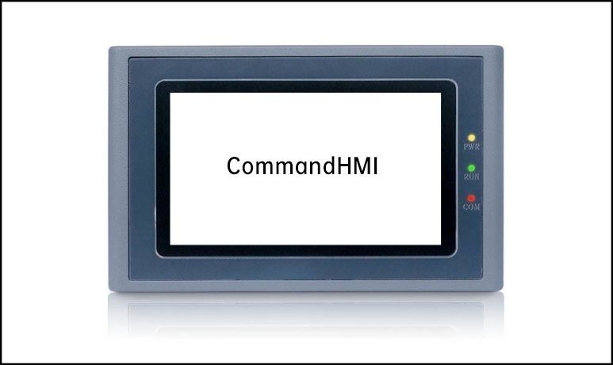

# General

HM series HMI of ACE AUTOMATION is a high-quality human machine interface product, integrating entirely CPU unit, input and output unit, display, memory and other module units. It can be widely applied in industrial control systems of all sectors of industry.

With the optimal design via hardware and software, it accords with requirements of machine control for touch precision and accuracy, as well as for screen colors.

On the basis of the previous version, HM series HMI makes great improvements with a faster boot time, higher page switching speed, higher communication speed, and higher sensitivity than before.

The following is an introduction to the HM series HMI:

**1.CPU unit**

Adopt ARM Cortex-A7 1GHz, Dual-core processor ensuring faster operation speed, less power dissipation as well as more stable operating.

**2.Touch tablet display unit**

Employ a four-wire resistive touch tablet responsible for a better touch precision and a long life of touch. The display is TFT LCD with 2,6 million color TFT.

**3.Communication module**

Design of anti-jamming, anti-hypertension and anti-lightning enhances the accuracy and reliability of communication. Support for RS232, 485, 422 communication modes.

**4.Storage cell**

Employ the Flash memory of preservation of digital as ROM; Available for a fast access speed; Capacity of all models reaches to 128M.

**5.Power module**

Inclusion of high-precision switching and regulated power supply; Low power consumption.

**6. Chip**

ARM Cortex-A7 1GHz,Dual-core.

E.g. HM-070AE：

HM：It represents the HM series，

070：Size (7.0 Inch)，

AE：It shows the model

        HMI of the ACE AUTOMATION HM, as open HMI products, it provides a standard serial interface that can be connected to other devices. Mainly supporting serial communication, it can communicate with today's major PLC on the market, such as CommandHMI, MITSUBISHI, SIEMENS, OMRON, MODICON, etc.. Meantime we can also develop communication drivers according to customer’s demand.

The configuration software of the HM is CommandHMI providing users with functions of screen configuration, driver settings, and control and so on.
