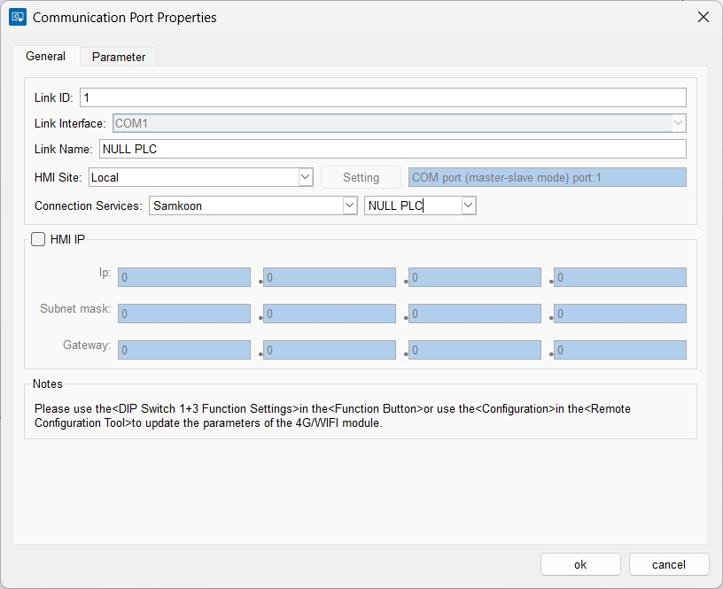
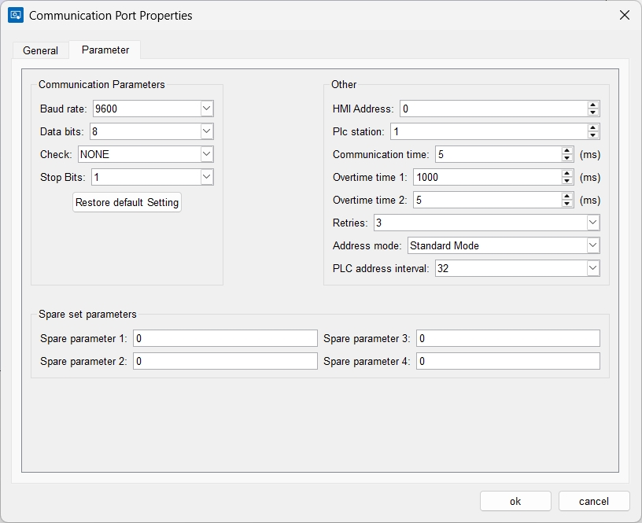
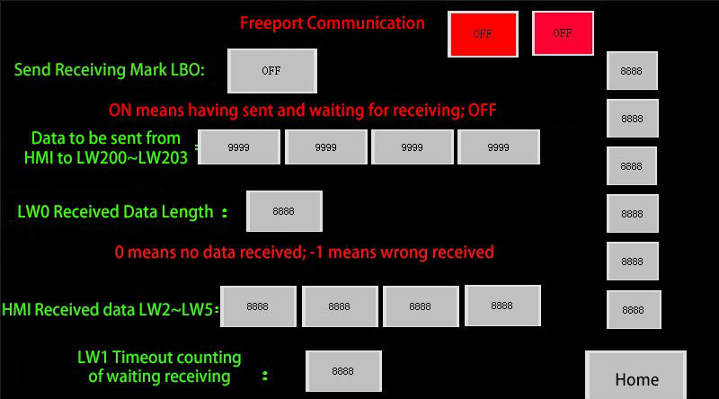
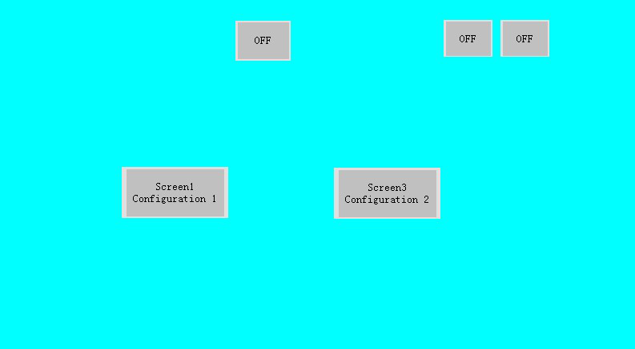
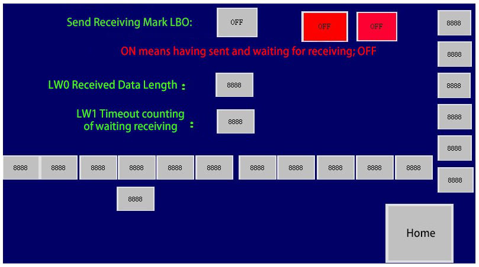
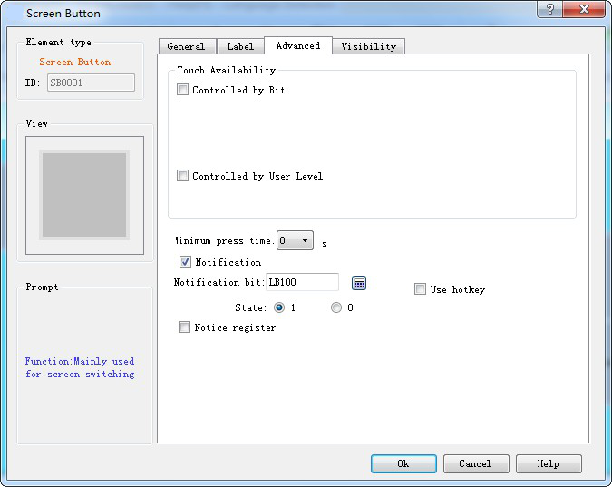
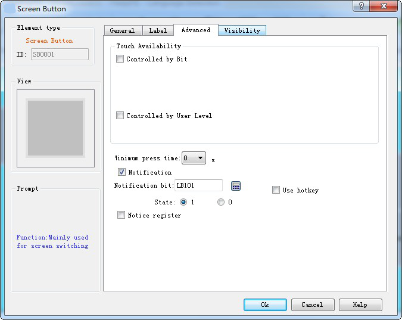
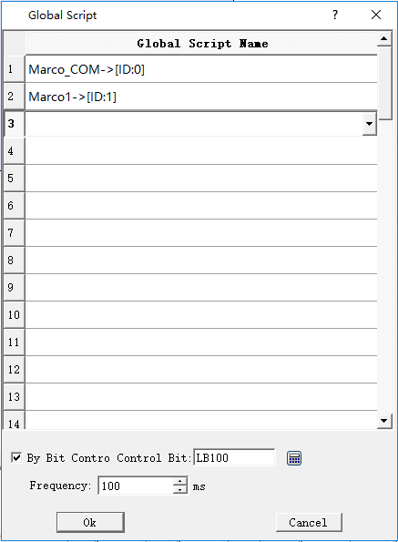
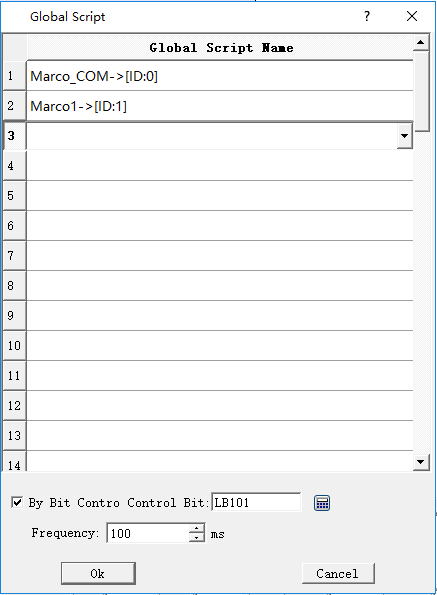

# Free Port Communication Protocol Case

Free communication parameter Settings, As shown below:



The com mouth is set to Samkoon – NULL PLC

The communication parameters are default as follows:



First, create three configurations:



Configuration 1



Configuration 2



Configuration 3

The six controls on the right side of Configuration 1 and 3 are numeric display controls whose monitoring addresses are respectively LW60297, LW60298, LW60299, LW60300, LW60301 and LW60302 = 1, from top to bottom. Two red controls are that of bit indicator light whose monitoring addresses are LB100 and LB101, respectively. Controls below Configuration 3 are numeric display controls, starting at address LW400 with an address interval of 1.

The "Advanced" settings for the two screen buttons in Configuration 2 are:





Global script setting:





**Code of Marco_COM：**

```c
#include "MacroInit.h"
void Macro_main(IN *p)
{
```

MarcoInit

```c
LW60297=0;
LW60298=3;
LW60299=0;
LW60300=1;
LW60302=1;
char Pdata[20];
char Gdata[100];
int result;
if (LB0==0) // 0 means state of sending; 1 means state of waiting reception
{
Pdata[0]=LW200;
Pdata[1]=LW201;
Pdata[2]=LW202;
Pdata[3]=LW203;
PUTCHARS(0,Pdata,4);
LB0=1; //
return; //
}
```

else

```c
{
result=GETCHARS(0,Gdata);
LW0=result;
if (result<=0) // 0 means no reception while 1 means wrong reception
{
LW1++; // timeout, start to count
if (LW1>=3) // Wait for execution time of 3 macros
{
LW1=0; // zero clearing
LB0=0; // send the mark of zero clearing; send it the next time
}
return; // quit directly
}
else // correct reception
{
LW2=Gdata[0]&0xff; // data reception processing
LW3=Gdata[1]&0xff;
LW4=Gdata[2];
LW5=Gdata[3];
LB0=0; // processing completed; send it the next time of entrance
PUTCHARS(0,Pdata,0); //clear buffer
}
}
}
```

**Code of Macro1：**

```c
#include "MacroInit.h"
void Macro_main(IN *p)
{
```

MarcoInit

```c
LW60297=0;
LW60298=4;
LW60299=0;
LW60300=1;
LW60302=2;
char Pdata[20]; //send data and save arrays
char Mdata[100]; //receive data and save arrays
int result; //length of received returning data
if (LB0==0) //LB0 stands for sending accepted flag, 0 for state of sending and 1 for state of waiting reception
{
Pdata[0]=0x02; //send data, read holding register and the first byte is the address of slave station
Pdata[1]=0x03; //function code; read holding register
Pdata[2]=0x00; // starting address of data to be read
Pdata[3]=0x00;
Pdata[4]=0x00; //word length of data to be read
Pdata[5]=0x03;
Wcrc=CRC(Pdata,6); //CRC check the previous data
Pdata[6]=(Wcrc&0xff); //execute high-low interchange of CRC; P6 takes the low one
Pdata[7]=(Wcrc>>8); //P7 takes the high one
PUTCHARS(0,Pdata,8); //send function; send the whole data to serial port
LB0=1; // complete sending; wait for reception instead of sending the next time of entrance
return; //quit to wait for reception
}
```

else

```c
{
result=GETCHARS(0,Mdata);//receive function; save the received data to Gdata array
LW0=result; //check the receiving length
if (result<=0) //0 means no reception while 1 means wrong reception
{
LW1++; //timeout; start to count
if (LW1>=3) //wait for execution time of 3 macros
{
LW1=0; //zero clearing
LB0=0; //send the mark of zero clearing; send it the next entrance
}
return; //quit directly
}
else //correct reception
{
LW400=Mdata[0]&0xff; //data reception processing
LW401=Mdata[1]&0xff;
LW402=Mdata[2];
LW403=Mdata[3];
LW404=Mdata[4];
LW405=Mdata[5];
LW406=Mdata[6];
LW407=Mdata[7];
LW408=Mdata[8];
LW409=Mdata[9];
LW410=Mdata[10];
LB0=0; //processing completed; send it the next entrance
PUTCHARS(0,Pdata,0); //clear buffer
}
}
}
```


Name and address of variable setting are the same in function compile box.
