# A simple macroblock

Create a new project; select the appropriate HMI model. The script module will implement the following simple arithmetic functions: Initialize the "Numerical display" control with the array char source \[4\] = {2, 3, 4, 5} element value through the Init script; read the input data from the external through the numerical display control; and then the execution of the ADDSUM script will be triggered by pressing the "=" button and the result of its execution will be displayed via this control.

Detailed steps are as follows:

**Step 1: &lt;Create a new script&gt;**

Click the shortcut function button "script editor" on the left side of the toolbar, and then it will pop up a dialog box .

**Step 2: &lt;Create the macro Init&gt;**

Click the  button in the script editor interface, it will appear a new script on “Not Save”list, as shown in Figure 5-7; Modify the script name in Script edit control, and edit the source code on the Script Edit Window,as shown in Figure 5-8

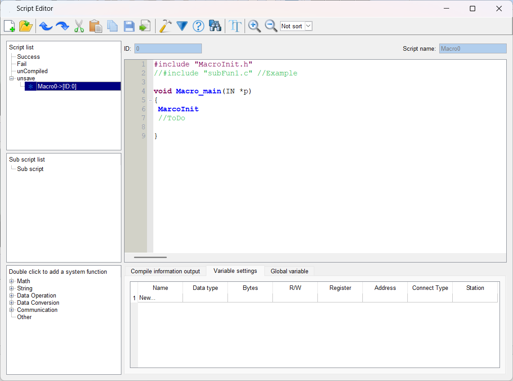

Figure 5-7      new a script

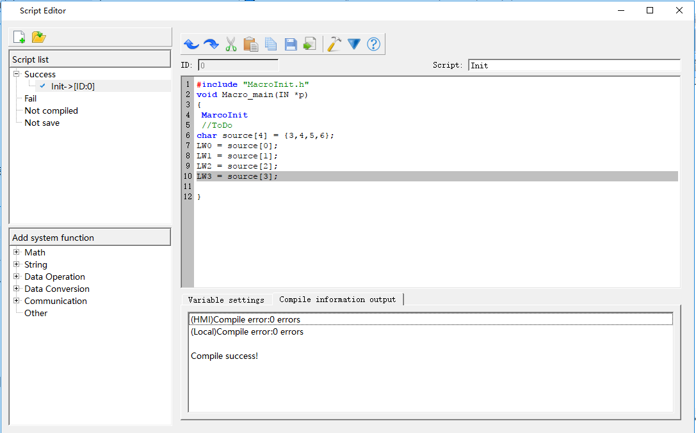

Figure 5-8 Edit Init Script

Macro names can only consist of Arabic numerals (0-9), English characters (a-z, A-Z), and underline (\_). Enter the following contents as shown in Figure 5-9:

**Step 3: &lt;Variable settings&gt;**

Record the attribute settings such as variable name, variable type, etc, in the window as shown in Figure 5-9. Double click in the "Variable Setting" window, or right click to pop up the shortcut menu, and then select "New Variable" item to pop up a dialog box as shown in Figure 5-10 where to set values of the external variables.

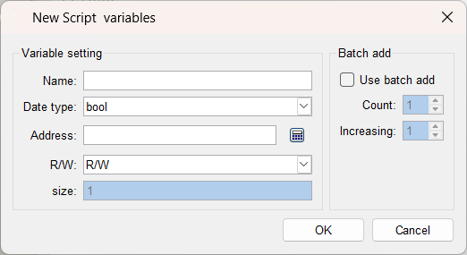

Figure5-9 Script Code Tag

Name: Input LW0, LW1, LW2, LW3 respectively in variable name;

Data Type: Set the 16-bit integer;

Read / write: Select to read and write (read and write);

The address settings are: LW0 = 0, LW1 = 1, LW2 = 2, LW3 = 3;

After the settings, the results are shown in Figure 5-10.

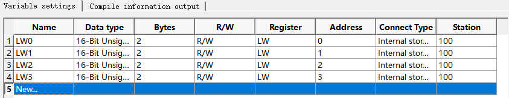

Figure5-10     Variable Setting

**Step 4: &lt;Compile the source file&gt;**

After completing the above steps, the next is to compile; click the compile button as shown in Figure 5-11, it will save, compile, connect and check other errors automatically.

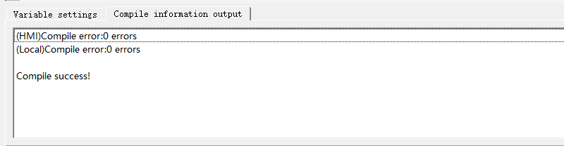

Figure 5-11    Information Output

When the message output window displays "0 errors! Compile successfully”, it indicates that this macro has been successfully created and will be automatically added to the compiled list box; otherwise, an error message will be displayed while the macro will be added automatically to the unsuccessful compilation list. Users can modify, edit the macro until the successful completion of the compilation.

**Step 5: &lt;Create the script ADDSUM&gt;**

Follow steps 2 - 4 to create the script ADDSUM, as shown in Figure 5-13

&lt;1&gt;: Enter "ADDSUM" in the script name.

&lt;2&gt;: Enter the contents of the circle in the code-editing window.

&lt;3&gt;: Set the corresponding variable attribute value in the variable setting window.

&lt;4&gt;: Click the Compile button.

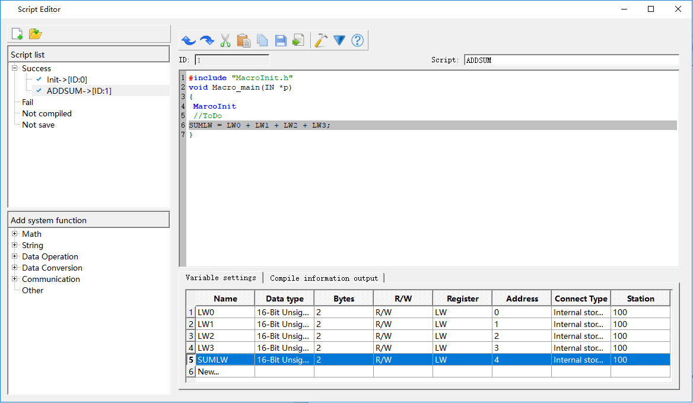

Figure 5-13    Creating the script ADDSUM

**Step 6: &lt;Edit Control&gt;**

&lt;1&gt;. Place controls on the project screen and adjust them to the appropriate size, as shown in Figure 5-14.

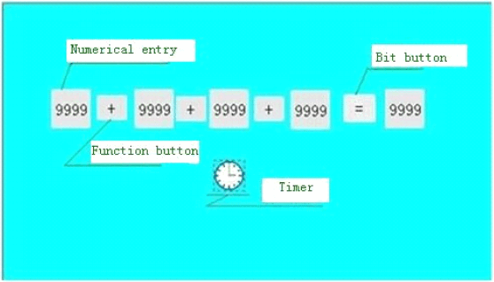

Figure 5-14    Control Layout

&lt;2&gt;. Set the corresponding control attribute parameters

Right click on the "Numeric Input" control and set the address value and attribute of each control, as shown in Figure 5-15.

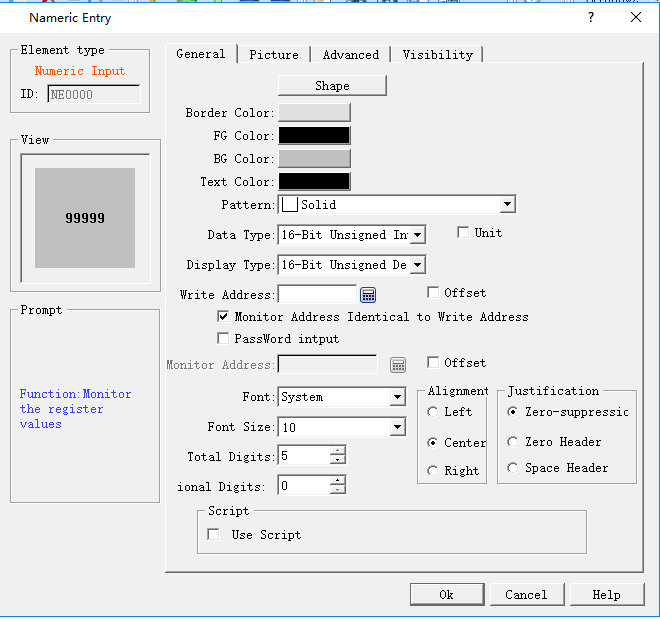

Figure 5-15    numeric input property setting

It is essential to ensure that the LW0, LW1, LW2, LW3, SumLW variable addresses correspond to the "write address" (shown in Figure 5-15) of each control. Click "OK" button to save the settings.

&lt;3&gt;. Set properties of Bit button control

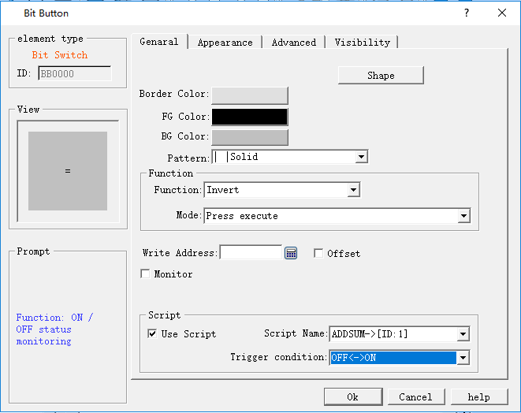

Figure 5-16 (Bit Button Property Setting)

&lt;4&gt;. Property setting of Timer

Select the script Init; click "OK" to save the settings.

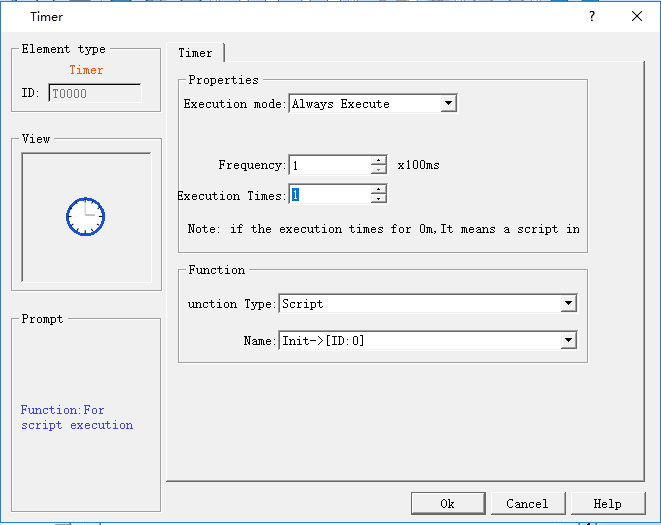

Figure 5-17    Timer Property Setting

&lt;5&gt;. Select the "Label" -&gt; "Text" page of the Function button, and enter the "+" character in the text box, as shown in Figure 5-18.

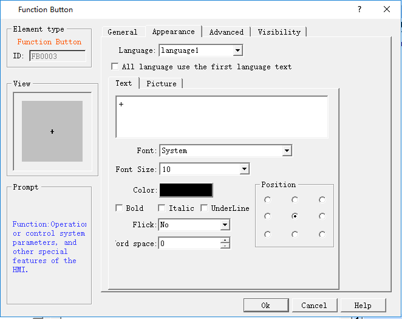

Figure 5-18    Function Button Property Setting

**Step 7: Compile and download to HMI**

&lt;1&gt;: Click the compile icon to execute the operation.

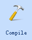

Figure 5-19    General Project Compile

&lt;2&gt;: Select "Download (D) -&gt; USB download (D)", then click “Download” in the pop-up dialog box. Restart the HMI.

You can also click the shortcut function button Compile Download.

**Step 8: &lt;Result Test&gt;**

After restarting the HMI, the following screen appears (Figure 5-20).

This is because at startup, the first instruction, Init, is the first to be executed by the timer.

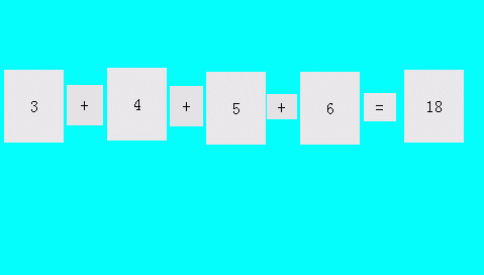

Figure 5-20    showing the initial value

Input data such as "31,42,53,64" respectively in the "Numeric display" control, click on the "=" button to implement the ADDSUM script and the output result will be 190, as shown in Figure 5-21:

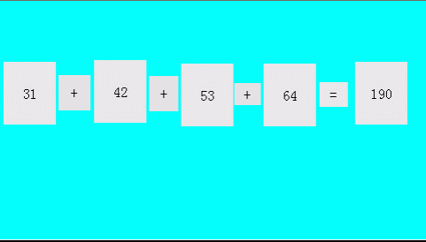

Figure5-21     result display

So far it has completed successfully the script editing, compiling, downloading, testing and all the necessary functions.
