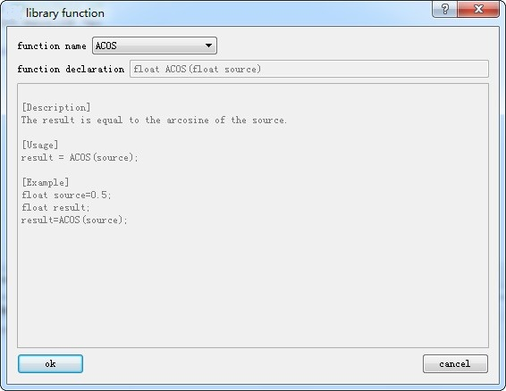

# Insert library function in the program

Click "function” button and pop up the dialog box as Figure 5-5. Select the corresponding library function in the function name list box, click “confirm” button and the function will be inserted to the cursor location of edition window automatically.

The functions, parameter types and other detailed instruction of library function refer to Appendix 1.

Figure 5-5 (Function Selection)
