# Function button introduction in script editor

The functional controls are arranged in script editor window as shown in Figure 5-3 (Script Editor).

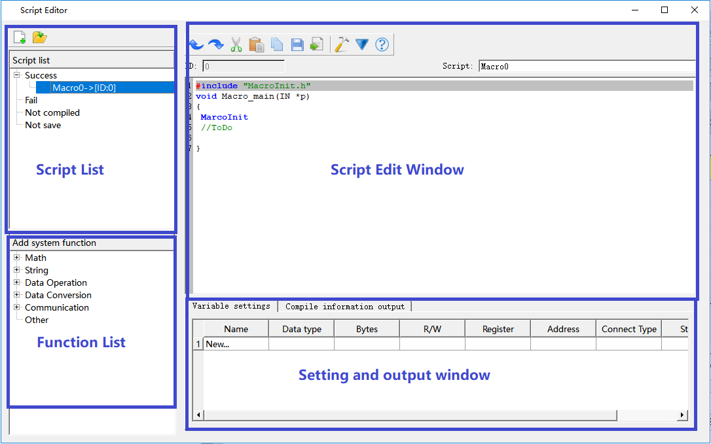

Figure 5-3 (Script Editor)

**&lt;1&gt; Script List:**

**1.**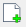**New:** new create a script

**2.**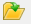**Import:** import an existence script.

**3.  Success:** the scripts have been successful completed

**4.  Fail:** the scripts have been failed completed

**5.  Not complited:** the scripts have not  been  completed

6\. **Not save:** the scripts have been saved

7\. **Delete: ‘**left click’ chooses the script,then ‘right click’ pop out ‘Deletes script’,click the delete

   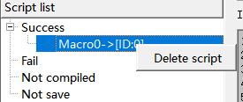

**
**

**&lt;2&gt; Script Edit window:** Edit and compile script on this window。“ID”:The number of the current edit script，“Script”:Modify the name of  the current edit script.

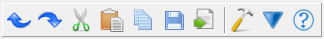：Script Edit Menu：there are ten button totally，as fllows：

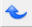 **Undo：**cancel the last operation.

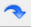  **Redo：**redo the next operation.

  **Cut**：cut the choosed script.

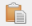 **Paste**：paste script.

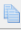 **copy**：copy script.

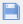 **Save**：save script.

**Export**：Pop the file save dialog，modify the root and name，save  the script as a \*.csv file.

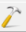 **Compile**：Compile the current script source code, and check the syntax error.

 **Pack/Show the setting and output window.**

 **Help**：Show the help file.

**&lt;3&gt;Setting and output window：**the window sets variable and outputs compiled information.

**“Variable Setting” Page:**click the “new”grid in this page，it will pop out the”New script variables”dialog, as shown in figure5.6.The variable associated with the register.

  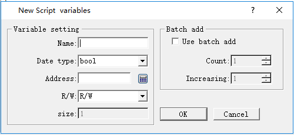

Figure5-5 New script variables

**“Compile information output”Page:**The window outputs the information of compilation and connection state of program. Users may make debugging and modification according to the information prompt.

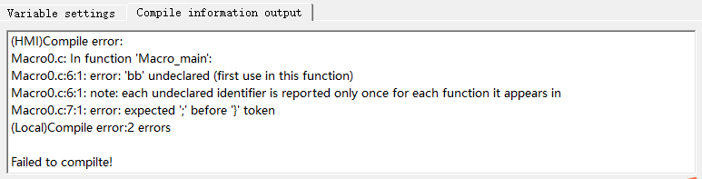

Figure5-6 Compile information output

**&lt;4&gt;Function List：**User can choose the system function,and insert it on the script edit window.
