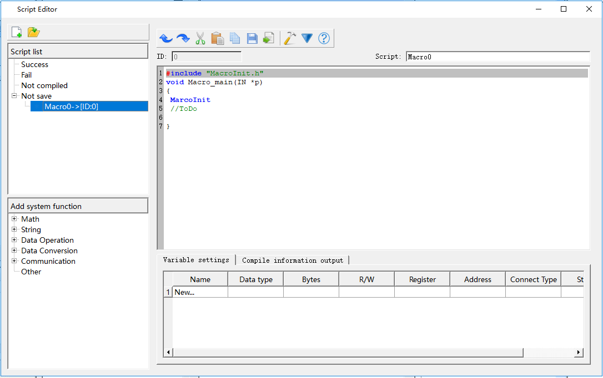

# New create script

Click    button and create a new script  on the “Not save” list  as shown in Figure 5-4 (Script Compiler)

Figure 5-4 (Script Compiler)

**Instructions:**

**Instruction 1: convention introduction of program compilation**

Create the source program of C language conforming to ANSI C standard in the edition window.

**Instruction 2: information output window**

The window outputs the information of compilation and connection state of program. Users may make debugging and modification according to the information prompt.

**Instruction 3: variable setting**

Variable name: input the variable name required in the program.

Data type: select the corresponding data class of variable name so as to distribute the corresponding memory size.

Bytes: set the occupied memory of corresponding variable automatically depending on the data class.

Read/write: set the read-write property of variable in the memory cell of touch screen.

Address: the defined physical memory address of variable in the touch screen.

Variable setting instruction: when the external requires interaction with touch screen such as data exchange and data acquisition, it provides the interface to change the behavior characteristics of touch screen dynamically.

Special tips: the variables required in the program should be put in the variable definition part (the variable definition starts from code).
