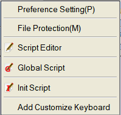
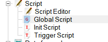

# Use script function to program

This section will introduce the basic functions of script and describe the relevant control functions and application method briefly.

There are ways to access script :

Method 1: select “Setting (S) -&gt; Macro" from the menu as shown in Figure 5-1 (script menu), and pop up interface as shown in Figure 5-1(script editor).

Figure 5-1 (Script Menu)

Method 2: click shortcut button “script ” as shown in Figure 5-2 (script button), and pop up interface as shown in Figure 5-3 (Script Editor).

Figure 5-2 (Script Button)
