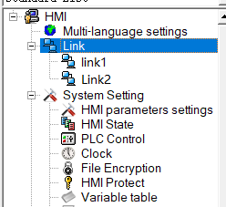
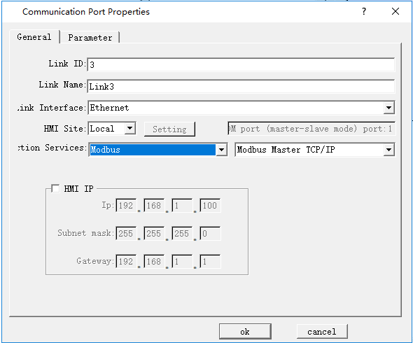
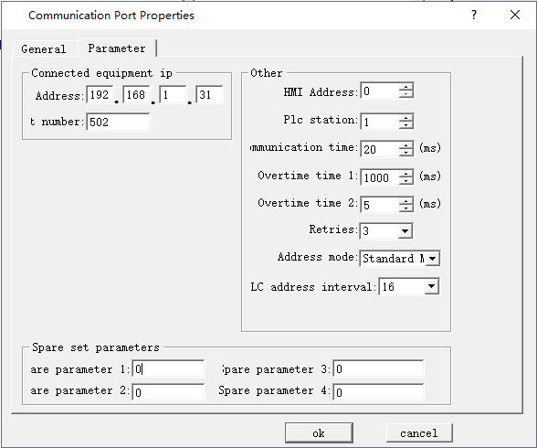
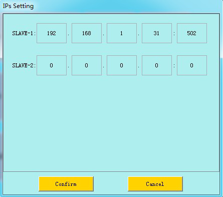
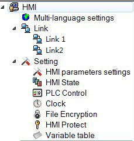
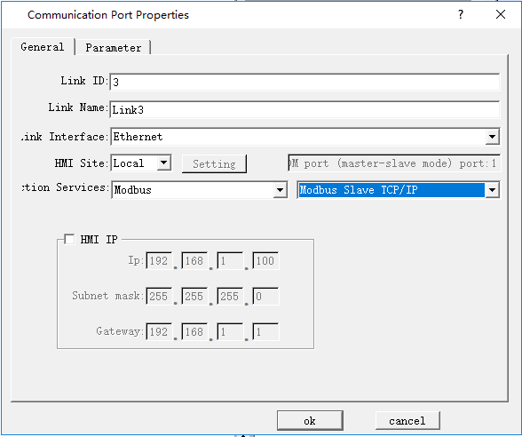
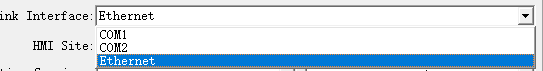
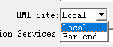
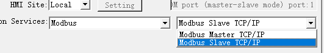
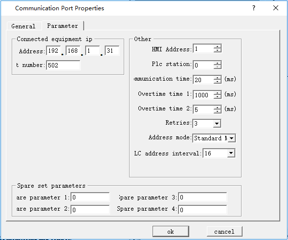

# Modbus TCP/IP

It is available to execute remote communication and control to HMI through the MODBUS TCP.

**Settings** when set HMI as Master station:

Double click “Connection 1” after creating a project, as shown below:

The "Communication Port Properties" dialog box is displayed (shown below).

Click "Parameter" in the pop-up "Port Properties" dialog box, enter the following dialog box to set the IP address and the port number (IP address and port are those of monitoring device). Choose standard address mode; Click "OK" to complete the settings.

If select "Extended Mode" for Address Mode, settings of IP address and port number here are invalid, while they can be set via the function button "Slave devices IP config" in the configuration.

During the configuration runtime, click the button to pop up the window for inputting the station number; input the station number, and then enter into the interface for setting the slave IP and port number, as shown in the following figure:

After the above settings, download the project into HMI; connect the master and slave station directly or through a router in order to perform operations of monitoring and control.

**Settings of slave station:**

**1. Set the IP**

First, use DIAL switches 1, 3 to set the IP address of HMI; in the pop-up IP setting interface, enter the IP address. In this example, set the IP address of slave station to 192.168.1.31. 2.

**2. Establish connections**

After creating the project, double click "Connection 1" in the following picture, as shown below:

The "Communication Port Properties" dialog box is displayed (shown below).

In the dialog box shown above, execute the following settings:

\* Connection Port: "Ethernet" (as shown).

\* HMI Site: Select "Local" (as shown).

\* Connection Service: Select "Modbus" - "Modbus Slave TCP / IP" (as shown).

Click "Parameter" in the pop-up "Port Properties" dialog box, enter the following dialog box to set the IP address (IP address of the slave station) and the port number. Click "OK" to complete the settings.

Download the project into HMI; connect the master and slave station directly or through a router in order to perform operations of monitoring and control.

Address is the internal address when HMI is set as slave station.
