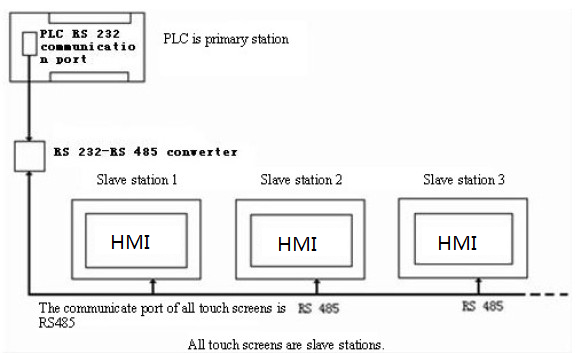
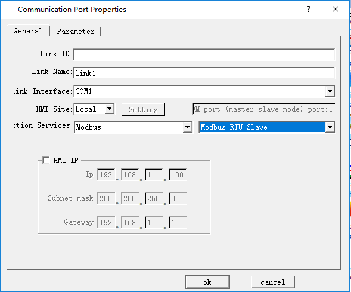
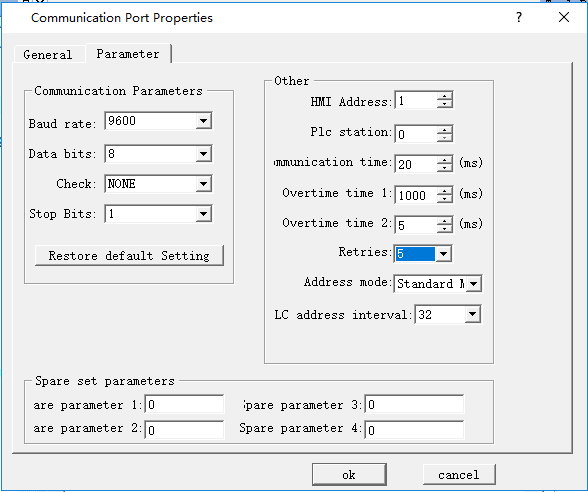
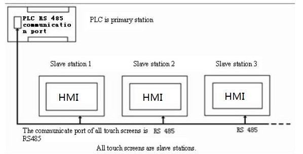
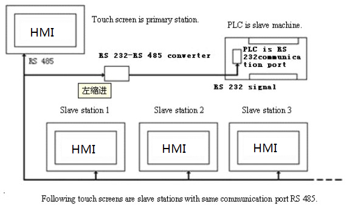
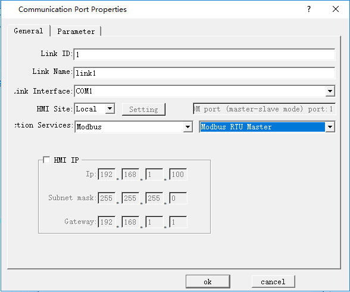
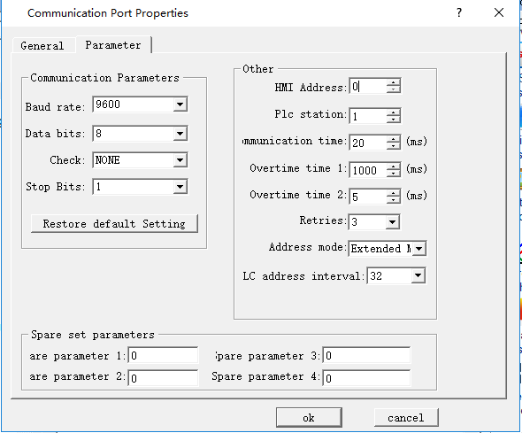

# “One machine with multiple screens” connection

CommandHMI HMI series touch screen allows “one machine with multiple screens” connection for PLC via MODBUS protocol. All touch screens are connected one by one, and the first screen is connected with PLC. All touch screens may be set as Slave Station, and PLC set as Master Station. Double click “COM1 connection” on the project manager, and then a communication port attribute-setting box will pop up. In Equipment Service item of General option in this box, choose Modbus RTU, and choose Modbus RTU Slave on the right; alternatively, set the first touch screen connected with the PLC as the Master Station, and set the PLC and other screens as the Slave Station. In this case, when setting the communication port attributes of the first screen, choose Modbus RTU in Equipment Service item of General option, choose Modbus RTU Master on the right, change the mode to Extended Mode in the Parameter option, and allocate addresses of touch screens. Thus, the touch screens set as Slave Station may communicate with PLC through the first touch screen. In both of these two arrangements, only Master Station can communicate with Slave Station, and no communication among Slave Stations can be achieved.

When the PLC is set as Master Station and all touch screens are set as Slave Station:

1. The communication port of the PLC connected is RS232; connection methods and system settings are as shown in Figure 8-1, 8-2 and 8-3：

Figure 8-1  Sketch map of “One machine with multiple machines” when PLC(RS232) is Master station

Figure 8-2 Choose MODBUS protocol, and set it as Slave Station

Figure 8-3 Allocation station address of HMI

2. The communication port of the PLC connected is RS485, connection method is as shown in Figure 8-4:

Figure 8-4  Sketch map of “One machine with multiple machines” when PLC(RS485) is Master station

When the communication port of PLC is RS485, as all touch screens are Slave Station, the system settings are the same as those when the communication port is RS232. Refer to Figure 8-2 and Figure 8-3.

When all HMI series screens are set as Slave Station, up to 255 screens may be connected. However, if many touch screens are connected, the response will be slow.

 When the first touch screen is set as Master Station, and the PLC and all other screens are set as Slave Station:

1.The communication port of the PLC connected is RS232; connection methods and system settings are as shown in Figure 8-5, 8-6 and 8-7：

Figure 8-5   Sketch map of “One machine with multiple machines” when PLC (RS232) is Slave station

Figure 8-6 Choose MODBUS protocol for the first screen and set it as Master Station

Figure 8-7 Extended are required when the first touch screen is set as Master Station

System setting of the touch screens set as slave station is similar as those shown in Figure 8-2 and Figure 8-3.

Note: As RS232 cannot support multi-drop connection, when the PLC in the “one machine with multiple screens” connection does not support RS485 port, a communication adapter is required to convert RS485 signal to RS232 signal.

Note: When HMI series touch screen is set as master station in the “one machine with multiple screens” connection, multiple protocols must be set for the address mode of the touch screen used as master station.

When set Modbus as Master station, it can add up to 255 Slave stations in principle; however, the more slave stations are set, the slower communication speed will be.
