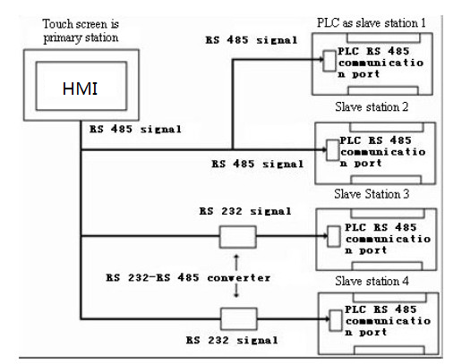
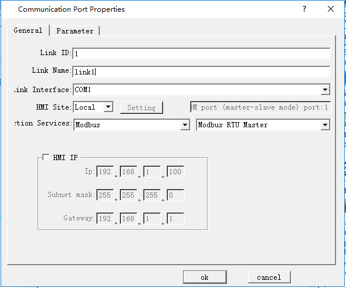
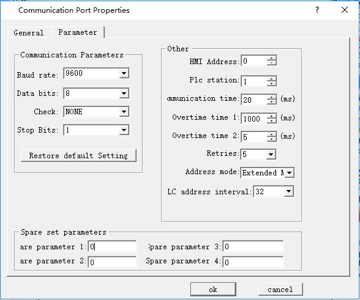
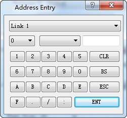

# “One screen with multiple machines” connection

HMI series allows not only “one machine with multiple screens” connection but also “one screen with multiple machines” connection for PLC via MODBUS protocol. In “one screen with multiple machines” connection, one touch screen may be used to directly operate the register address of several PLCs connected with it, so long as the PLCs support MODBUS protocol. At the time of system setting, choose Modbus RTU in Equipment Service item of General option and choose Modbus RTU Master on the right, so that the touch screen is set as Master Station and all PLCs are set as Slave Screens. Then, the touch screen may operate the register address of the PLCs. The register names of the PLCs correspond to the register names in MODBUS protocol.

Figure 8-8      “One screen with multiple machines” connection

Figure 8-9      Set the touch screen as Master Station

Figure 8-10    Extended Mode are required when the touch screen is set as Master Station

After above setting, the PLC addresses in the communication port attributes become ineffective. When user clicks a control to input address, an address input box as shown in Figure 8-11 will pop up. There is a dropdown menu on the right of the register name, and the protocol chosen from the dropdown menu is the Slave Station address of the PLC.

Figure 8-11    Address input box

**Instruction of extended mode stations enabling communication to control address：**

The address correspondence relation occupied by the control station number is 16 words corresponding to a serial port, that is, the maximum number of control enabling stations is 256, with LW59000 as the base address

COM1 corresponds to 59010~59025, LW59010 to station number 0~15, LW59011 to station number 16~31, and so on

COM2 corresponds to: 59026~59041, LW59026 corresponds to station number 0~15, LW59027 corresponds to station number 16~31, and so on

Ethernet correspondence: 59026~59041, LW59026 corresponds to station number 0~15, LW59027 corresponds to station number 16~31, and so on

The default is all on when HMI is open, you can use macro controlling every bit to start or stop connect station number.

Note: As RS232 cannot support multi-drop connection, when the PLC in the “one screen with multiple machines” connection does not support RS485 port, a communication adapter is required to convert RS485 signal to RS232 signal.
