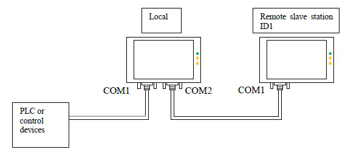
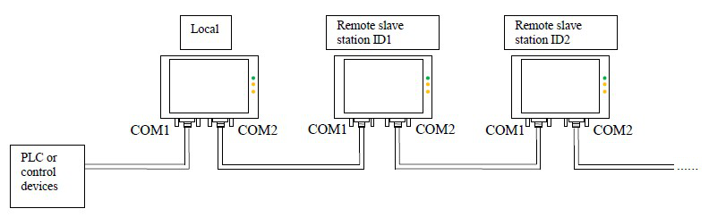
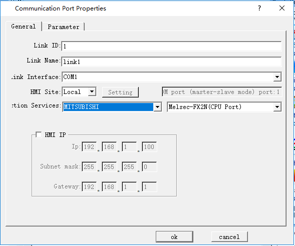
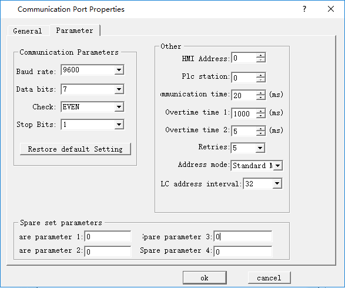
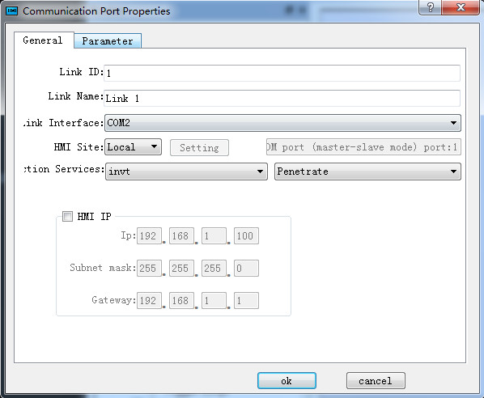
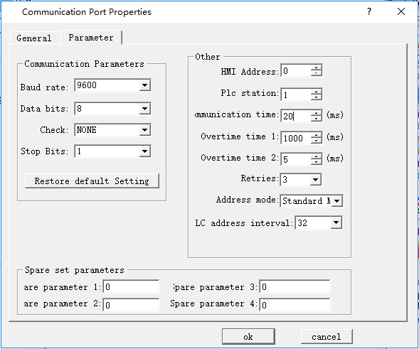
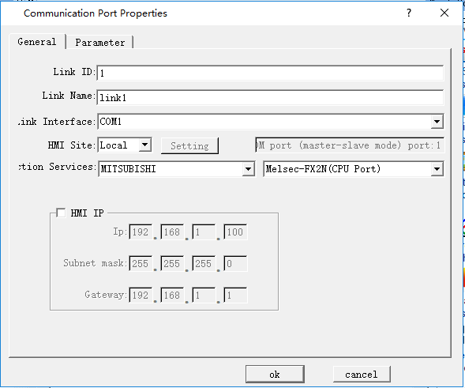
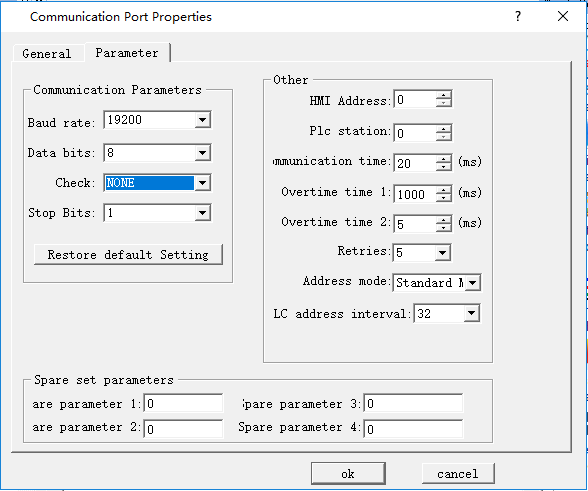

# Penetration connection

HMI touch screen allows a special connection manner, in which a remote HMI can monitor or control PLC or other devices via the serial port of another HMI connected with the PLC or device. In this case, there are two or more control terminals to operate the device connected. Penetration connection is a very useful function of HMI.

Before use penetration connection, the following terms should be understood:

• Local HMI: The HMI connected with the PLC or other device.

• Remote HMI: The HMI connected with the local machine that controls the devices connected through penetration.

To realize penetration connection, the local HMI must have two serial ports. The sketch map of penetration connection is shown in Figure 8-12 and Figure 8-13:

Penetration connection involving two screens:

Figure 8-12    Sketch map of penetration connection involving two screens

Penetration connection involving multiple screens:

Figure 8-13    Sketch map of penetration connection involving multiple screens

Local HMI: Software setting:

Double click the connection established, and then a communication port attribute-setting box will pop up. Choose COM1 for connection port. Taking MITSUBISHI penetration for example, the COM1 of the local HMI is connected with MITSUBISHI FX2N PLC. The communication parameters set in Communication Parameter should be consistent with the PLC or other devices connected. See Figure 8-14 and Figure 8-15:

Figure 8-14    General page of local HMI communication port attribute setting

Figure 8-15: COM1 setting page of local HMI communication port attribute setting

Create a new connection, choose COM2 for the connection port, add no protocol in Connection, set attributes as follows, and set the same serial port attributes as serial port 1. The recommended parameters are 9600, 8, None, 1. Choose Connect Slave Screen Port for penetration attribute, and set the number of screens according to actual condition. See Figure 8-16 and Figure 8-17.

Figure 8-16    General page of local HMI communication port attribute setting

Figure 8-17    Parameter setting page of local HMI communication port attribute setting

Choose default values for other parameters. At this moment, the parameter setting for local HMI is completed.

Remote HMI: Software setting:

Double click the connection established, and then a communication port attribute-setting box will pop up. Choose COM1 for connection port, choose Remote for HMI Site, and set the same communication parameters as those in the COM2 parameter setting page of local HMI communication port attribute setting (as shown in Figure 6 above), as shown in Figure 8-18 and Figure 8-19.

Figure 8-18    General page of remote HMI communication port attribute setting

Figure 8-19    Parameter setting page of remote HMI communication port attribute setting

Choose default values for other parameters. At this moment, the parameter setting for remote HMI is completed.

Note: The above settings are software setting for penetration involving two screens.

Note: In penetration connection involving multiple screens, COM setting in remote HMI is the same as COM setting in local HMI.

Note: As all communication data are exchanged with PLC through COM1 of local HMI, the communication rate will be low in the case of penetration connection involving multiple screens.
