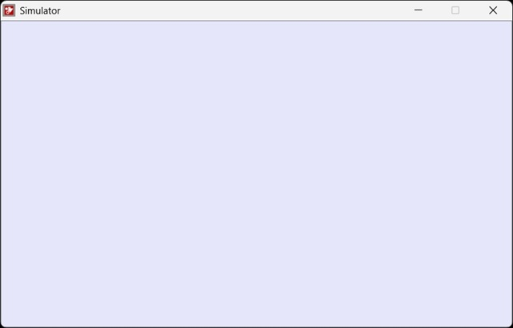
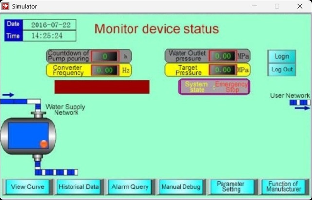
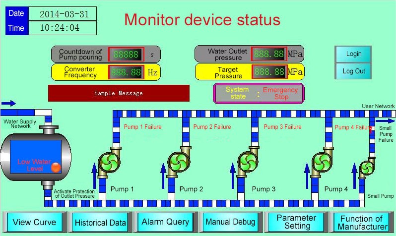

# Offline Simulation

You can check the correctness of the configuration project with the off-line simulation provided by CommandHMI before transferring it to the HMI and connecting the HMI to connected devices.

**Operation process:**

Save the current project, select the offline menu to execute the simulation command, then it appear a pop-up offline simulation window where you can control the project to realize part of HMI functions by clicking the mouse instead of touching the HMI, as shown in Figure 6-1:

Figure 6-1 Diagram of HM-070BE offline simulation

In the simulation window, right click to bring up the following menu:

• Exit: Close the offline simulation window; press the keyboard ESC can also exit the offline simulation.

• About: About the dialog box.

You can close offline simulation through taskbar “Right Key”-“Close”.

**Offline simulation example**

As shown in Figure 6-2, the edited configuration project can be off-line simulated so as to check and find errors in engineering configuration screens, such as whether the monitor address is correct and so on. Just in case.

Figure 6-2 Example of HM-070BE offline simulation

**Steps to execute offline simulation:**

Install CommandHMI Software first;

Run CommandHMI as Administrator.

Note: In the offline simulation, only these functions of Function button are available: “Previous formula", "Next formula", "Save current formula", "Change User’s Level", "Logoff" and "Touch Sound ON / OFF ". The Historical Alarm, Historical Data Display, Historical Trend Graph, Timer, and Macro on the Toolbar cannot be simulated.

The other controls are the same operation. After setting properties of each control, click "Save" and then select Offline simulation, as shown in Figure 6-3:

Figure 6-3          Offline simulation
