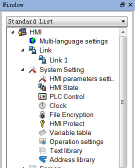
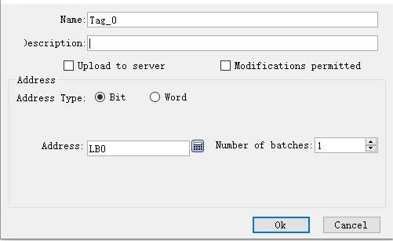
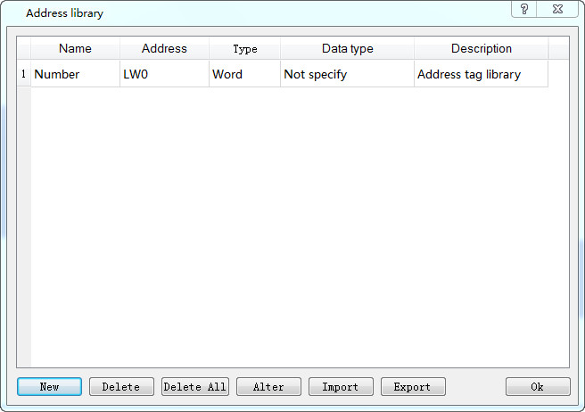
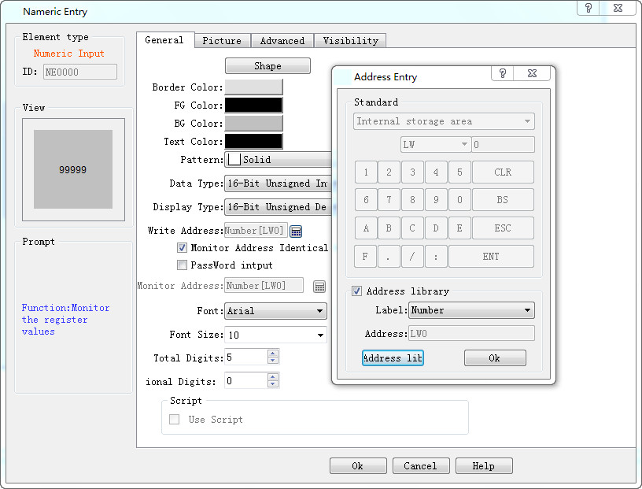
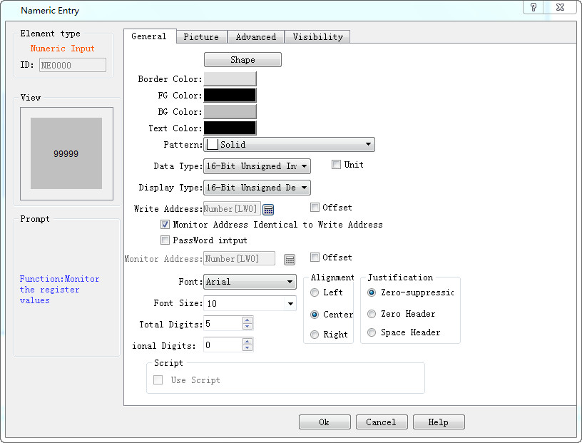
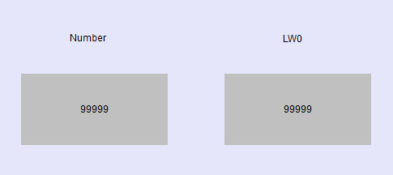
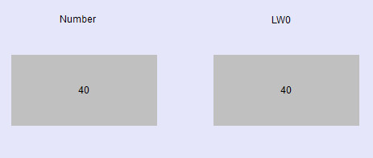
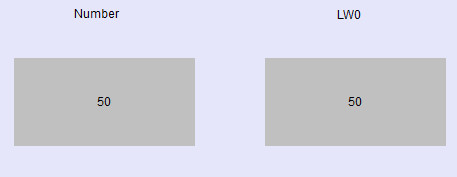

# Address Library

The address library control, the user is an alias for the register, and the user can access the variable that needs to be read in two ways of using the address tag and the register address.

The use of the address library is described below

Ø  Set the address library tag

Double-click the "address library" option to pop up the following dialog

Click the new button to pop up the following dialog

Description:Add the description information to the current added address library tag to facilitate users to view the current variable information and USES

Command: the custom address tag is the equivalent of setting an alias for the register, which can be used in the direct space to select the variable alias to achieve the use of the register

Address type: set the data type of the variable alias, and there are only two options

Address: set the register address associated with the address tag

Address number: users can add address tags in bulk, and the current address tag function only supports the operation of a single variable, without an array of address tags

Set up a lw0 address tag number in the figure below, and the following diagram is shown as shown in the following diagram

Ø  Use the address library tag

The lw0 address tag, defined in the figure above, is used as an example to describe the usage of the address

Select the select address input control, select the address tag library, select the label that you need to use, and see the address in the address of the site label in the address, click the address library, and the user can view all the address tags that the current user defines.

The following diagram is shown following the completion

In the image, a numeric input control is placed, the address lw0, as shown below

Download to the touch screen or use in the online analog function monitor operation effect, this is an example of the online simulation, and the input data 40,lw0 registers in the number changes, and the input in the lw0 is also changed

Address tag function, convenient for users to define a special address label for the commonly used register, use the change address label in the configuration program, reduce the user's cumbersome address input, and make it easier and faster to complete the writing operation of the configuration
