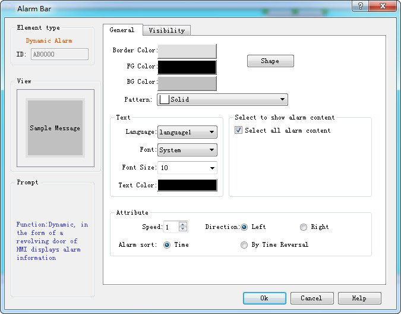
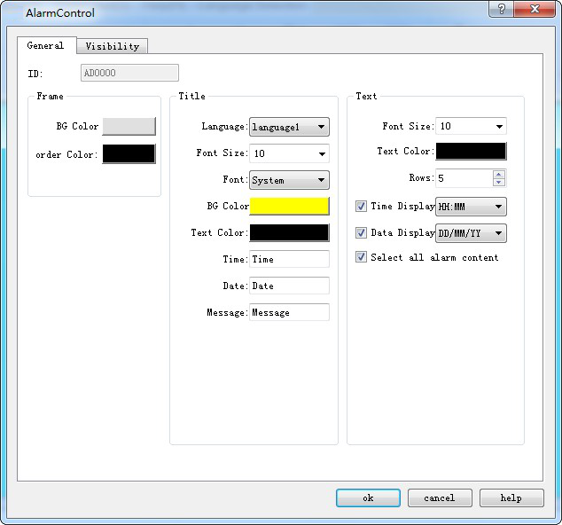
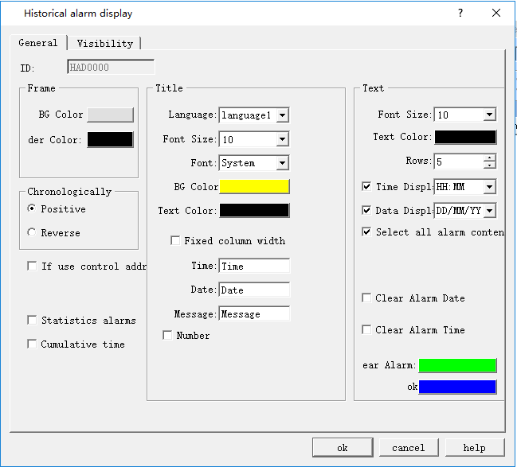

# Alarm Display Controls

It can add alarm display control after the settings: Alarm Display, Alarm Bar and Historical Alarm Display.

Select in the toolbar menu to set the alarm bar display parameters in the dialog box, as shown in Figure 7-30:

Figure 7-30 Alarm Bar dialog box

• Speed: the movement speed of the alarm information;

• Direction: The alarm bar moves from right to left or left to right;

• Alarm sort: The display order of alarms by chronological order or by traverse chronological order.

Select the alarm control in the toolbar menu to set the alarm display text and parameters in the dialog box, as shown in Figure 7-31:

Figure 7-31 Alarm Display dialog box

Select the historical alarm display control in the toolbar menu to set the display content and parameters in the dialog box, as shown below:

Historical Alarm Display dialog box
