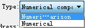
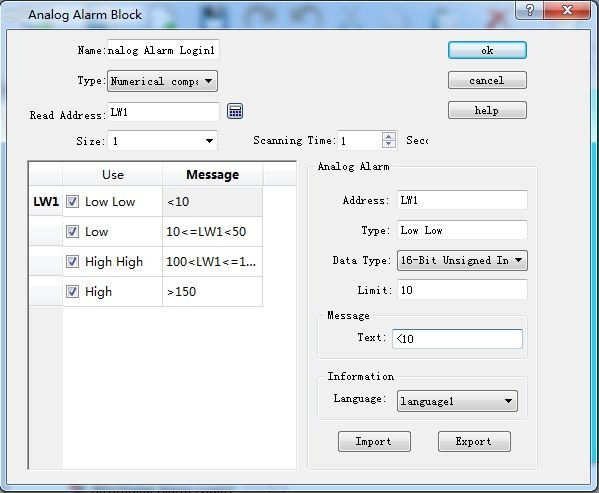
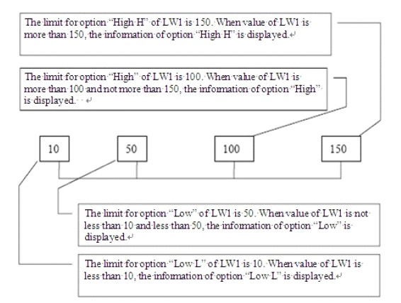

# Analog Alarm Login

Open the analog alarm settings dialog box, as shown in Figure 7-28:

It has two types: Numerical value and Numerical comparison.

The numerical comparison alarm is as shown below:

Figure 7-28    Analog Alarm Login dialog box

If user needs to use the analog alarm, steps are as follows:

• First input the address in the "Read Address" column to alarm. It is assumed here that the internal address LW1 is set.

• Select the total number of alarms in the "Size" option, which means the total number of addresses; data type decides the way to read address. Each address value is set firstly as the 16-bit data type and it is continuous. But the data type can be changed. As shown in Figure 7-28, the LW1 address chooses a 32-bit positive integer while LW3 and LW4 values are 16-bit positive integers. Therefore, when 32-bit data is selected for an address, the later address value to be read is added by 2 on the basis of the former address value; and if the 16-bit data type is selected, the later address value to be read is the former value plus 1.

• Users can set the "Scanning time" of the alarm, which means the scanning frequency.

• Click each item to input a value in the “Limit” box on the right; then enter the text information (alarm content) in the “Text" box. Here assume that the message is as shown in Figure 7-28: each address value can be classified into one of four ranges-- Low, Low Low, High, High High.

As shown in Figure 7-29:

Figure 7-29    Diagram of the four address values for the LW1 address

• Low Low: When the value of this item is less than the limit of this setting and the "Use" option is selected, the alarm information of this item will be displayed in "Alarm Control" or "Dynamic Alarm Bar";

• Low: When the value of this item is no less than the “Low Low” limit while less than the “Low” limit and the "Use" option is selected, the alarm information of this item will be displayed in "Alarm Control" or "Dynamic Alarm Bar";

• High: When the value of this item is greater than the “High” limit while no greater than the “High High” limit and the "Use" option is selected, the alarm information of this item will be displayed in "Alarm Control" or "Dynamic Alarm Bar".

• High High: When the value of this item is greater than the limit of this setting and the "Use" option is selected, the alarm information of this item is displayed in "Alarm Control" or "Dynamic Alarm Bar".

• U export: export alarm settings information

• U import: import alarm settings information

Refer to “Digital Alarm Login” for the application of “Use”.

Numerical value alarm means an alarm occurs when the value reaches the set limit value.

The settings are as follows: Alarm is triggered when the alarm value reaches 1, 12, 30 and 40.

Note: Number of analog alarm is up to 10 for HM series HMI.
