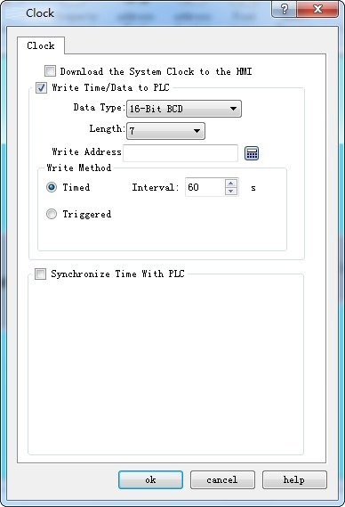
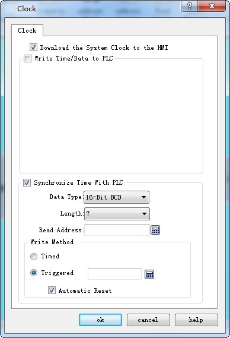

# Clock

Clock setting includes three functions: downloading system time to HMI, writing time to PLC and synchronization with PLC.

Double click “Clock” in the Project Manager to open the attribute setting box of Clock.

Figure 7-11 Clock Setting dialog box

Download system clock to HMI: Whether to download the system clock information to HMI.

• Write time/date to PLC:

• The Data type and Length are default values.

• Time: Year-Month-Day-Hour-Minute-Second-Week. Refer to LW 60000~LW 60006 in Register Address for detailed information. It cannot modify the Week in the system time.

Write address: The system time information will be written into this PLC address.

• Startup Method:

Timing: Write the system time information into the specified PLC address periodically at specified time internal.

Trigger: The system time information will be written into the specified PLC address when the trigger address is 1.

Auto Reset: Reset automatically the trigger address to 0 when it is 1.

**Synchronization with PLC time:**

The Data type and Length are default values.

 Time: Year-Month-Day-Hour-Minute-Second-Week. Refer to LW 60000~LW 60006 in Register Address for detailed information. It cannot modify the Week in the system time.

• Read address: The information in the PLC address will be read.

• Startup Method:

Timing: Write the system time information into the specified PLC address periodically at specified time internal.

Trigger: The system time information will be synchronized with the PLC when the trigger address is 1.

Auto Reset: Reset automatically the trigger address to 0 when it is 1.
