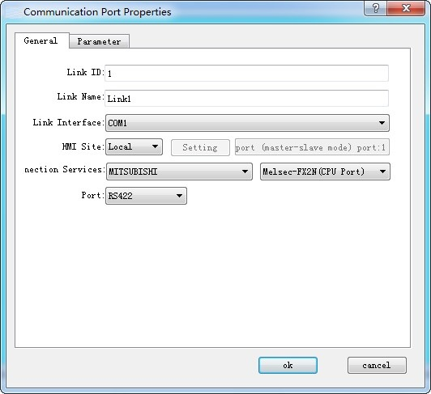
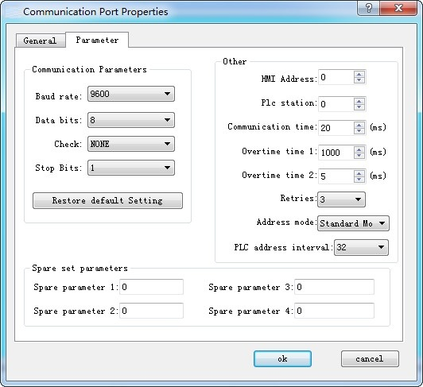

# Communication Port Property

Communication port property is applied to set the communication parameters between HMI and connected devices.

Double click Link" and Link 1, as shown in Figure 7-1:

Figure 7-1      COM1 COM port property dialog box

In the "Link" page, various brands and models of PLC are available. In addition, the "Link name" and "PLC consecutive address interval"

Click the Parameter tab of the dialog box, as shown in Figure 7-2:

Figure 7-2      COM1 Communication port parameter setting

**Parameter settings:**

Equipment services: manufacturer, PLC brand and CPU model.

Port: RS232 / 485/ 422

Baud rate: 1200/2400/4800/9600/19200/38400/57600/115200 / 187.5k

Check: Odd / Even / None

Data bits: 7/8

Stop bits: 1/2

Model: PLC model

HMI station number: Set the station number of the HMI

Communication time: HMI sends data to the PLC and receives the data from PLC, and it cannot send data again until after the set communication time.

Overtime time 1 and Overtime time 2: Calculate first the value of Timeout 1 divided by that of Timeout 2, as shown in the figure above: the timeout period is 200ms. There is a situation called timeout if the HMI has not received the data 200ms after sending data.

Number of retries: The number of times that the data is retransmitted after a timeout

Address mode: ① Standard mode: One serial port connects one PLC; ② Extended mode: One serial port connects multiple PLCs of the same type

PLC Continuous Address Interval: The maximum number of words that PLC can read at one time
