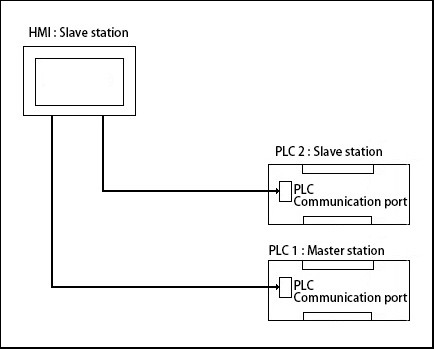

# Data forwarding

**Function of Data Forwarding:**

1、Data Forwarding apply to transfer data between devices connected to two ports of HMI.

Example：

Select Modbus RTU Slave protocol for Port 1; Take HMI as slave station; master station Device 1 read the address of LW0 in HMI.

Select Modbus RTU Master protocol for Port 2; HMI reads the address of 4x11 of Slave station 2.

