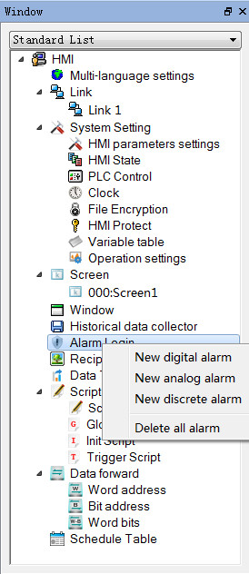
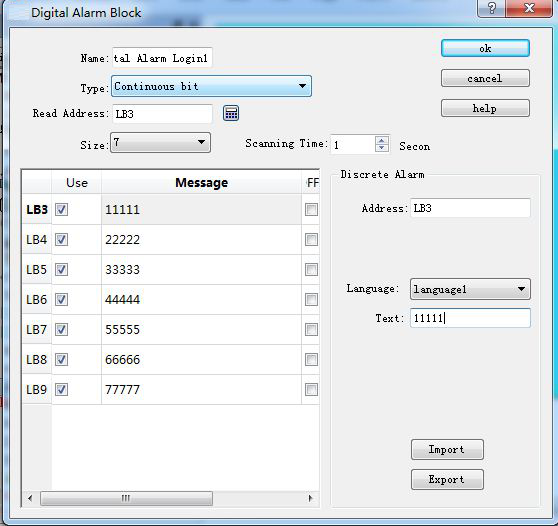
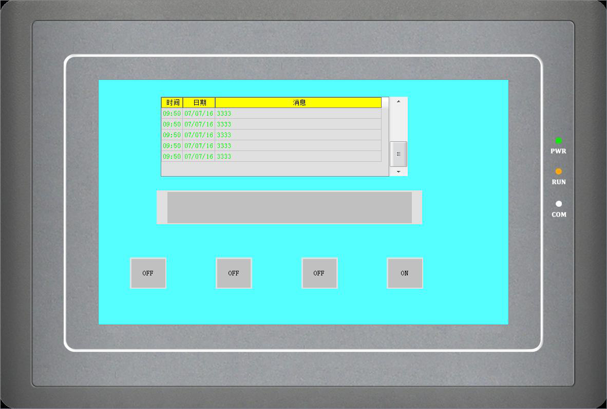
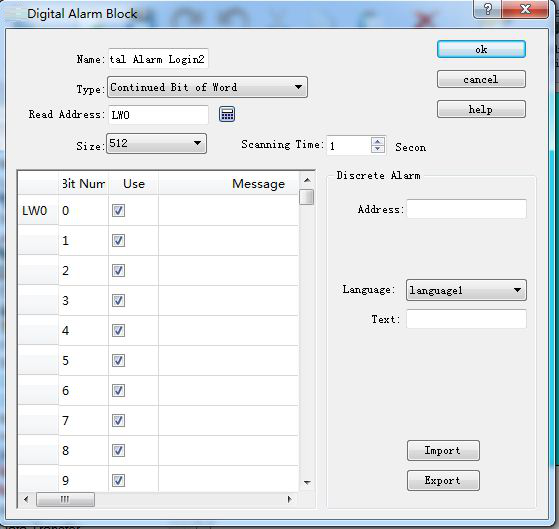
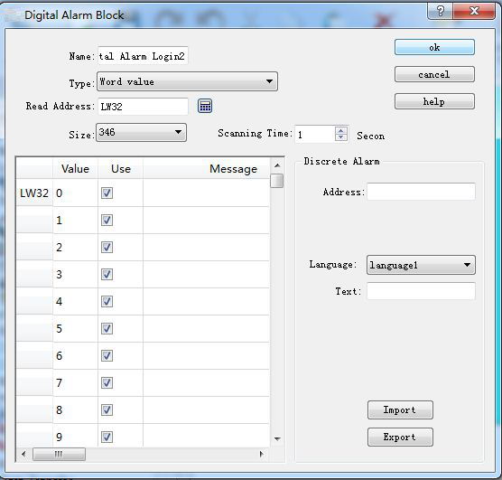
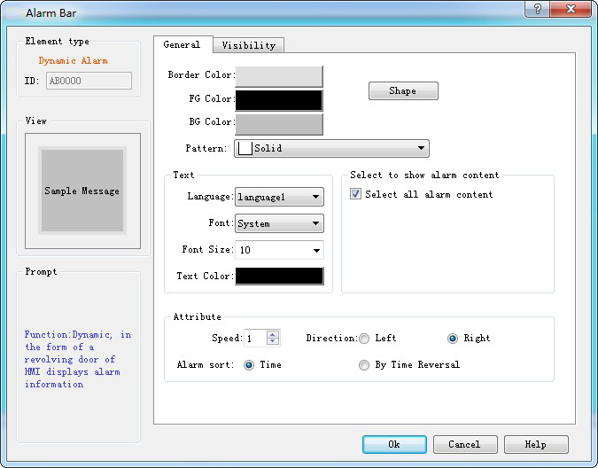

# Digital Alarm Login

Alarm Setting is employed to display alarm information, only with which the alarm control and alarm bar run normally (in fact, the alarm control and alarm bar displays the alarm message of "digital alarm login" and "analog alarm login").

Right click the "Alarm landing" in the Project Manager and select "New digital alarm", as shown in Figure 7-22:

Figure 7-22    Select alarm log

Double click the "digital alarm login" option to open the digital alarm settings dialog box, as shown in Figure 7-23:

Figure 7-23    Select continuous digit

Steps to build a digital alarm log are as follows:

• Enter the read address first; it is assumed here that the internal address LB1 is set.

• In the "Size" column, select the total number of alarms, i.e. the total number of bit addresses, which is continuous. It is assumed here that the set value is six.

• Set the bit alarm “Scanning time", that is, the scanning frequency.

• Click an item in the list box, and then move the mouse to the right of the "Message" module; input text information in the “Text” edit box serving as the alarm content. Here assume that the alarm messages are as shown in Figure 7-23.

• If "Use" is selected, the alarm information will be displayed in "Alarm Control" or "Alarm Bar". Otherwise the alarm message will not appear even if the corresponding address is 1. If the address value of this item is 0, the alarm information does not show.

• OFF Alarm: When this option is selected, the alarm will be generated when the corresponding address value is 0 (OFF value). Otherwise, an alarm will be generated when the address value is 1 (ON value). By default, an alarm occurs when the address value is 1 (ON).

• U export: export alarm settings information

• U import: import alarm settings information

Here is an example: Suppose the choice of type is "Continuous bit".

• If the value of LB1 address is 0, the alarm information will not be displayed in "Alarm Control" and "Alarm Bar", regardless of whether the "Use" option is selected or not.

• If the value of the LB1 address is 1 and the "Use" option is not selected, the alarm information is not displayed in the "Alarm Control" and "Alarm Bar".

• If the value of LB1 is 1 and the "Use" option is selected, the alarm information will be displayed in "Alarm Control" and "Alarm Bar".

Click "OK" to complete digital alarm settings. Users can add 6 bit buttons with the function of Alternation whose address is LB1-LB6; place controls of "Alarm" and “Alarm Bar" on the screen; then execute offline simulation to check whether it displays alarm information.

The following is an example of offline simulation as shown in Figure 7-24:

Figure 7-24    Offline simulation example of digit alarm

When "Continuous Bit of Word" is selected as the Type, as shown in Figure 7-25 below:

Figure 7-25    Select Continuous Bit of Word

If the “Use” of a certain bit number is selected, an alarm will be generated when the value of this bit value is 1.

Note: When copying the contents of alarm messages from other documents to the alarm text of digital alarm log and analog alarm log, please make sure that there is no line break (invisible) in the message. It is recommended to input the message manually rather than copy and paste, in case of display error of alarm message.

If "Word value" is selected for the type, as shown in Figure 7-26 below:

Figure 7-26    The "Word Value" digital alarm dialog box

When a value of the address is selected, the alarm is generated when the value of the address is equal to the value selected in the list.

Place an Alarm control with 7 lines as the example in Figure 7-24 and a Dynamic alarm bar whose attributes are set as shown in Figure 7- 27:

Figure 7-27    Dynamic Alarm Bar Properties dialog box

Add lastly six bit buttons whose write address is LB1-LB6 with the "Alternation", “Monitor” and “Monitor Address identical to Write Address” functions set for each. After the settings, click the "Save" button on the toolbar to save the project, execute the "Offline" command in the "Download" item in the menu bar, and then click the bit buttons LB1, LB2, LB4 and LB6. In this case, the Alarm control and Dynamic Alarm Bar will display the alarm information of LB1, LB2, LB4, and LB6 in the "Digital Alarm" When click them again, "Alarm Control" and "Dynamic Alarm Bar" will display nothing since their values are 0 because of the alternation function.

Note: Different alarm information is available for corresponding language through the function of switching language.

Note: Number of digital alarm is up to 10 for HM series HMI.
