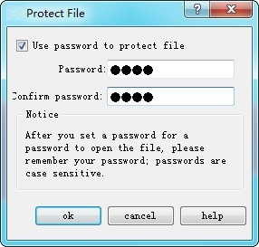
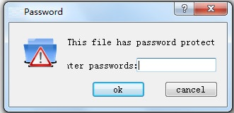

# File Encryption

Whether a password is necessary to open the project file.

Double click the "File Encryption" option in the “Project Manager", as shown in Figure 7-12 pop-up dialog box:

Figure 7-12    File Encryption dialog box

Select the "Use password to protect file" in the above dialog box; enter in the Password and Confirm Password; click "OK" to complete.

In this case, if user reopens the project, a password input box will be displayed as shown in Figure 7-13:

Figure 7-13    Password input box

Users need to input secret to open project.
