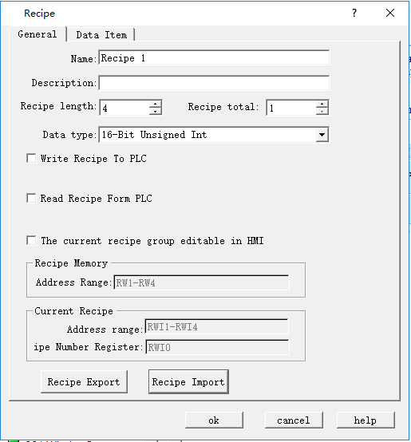
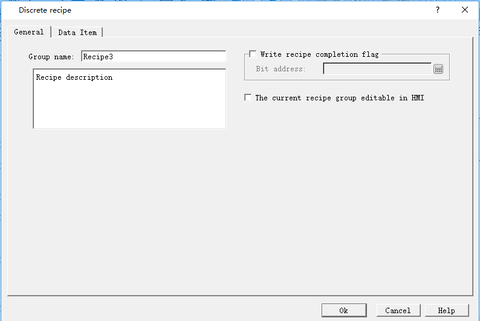
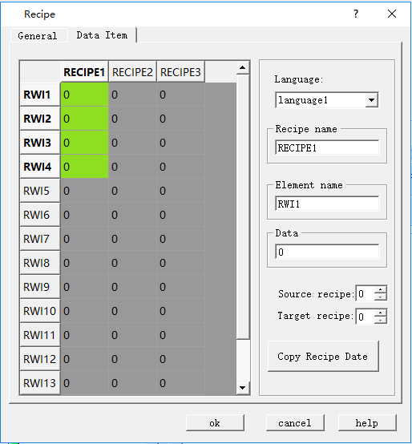
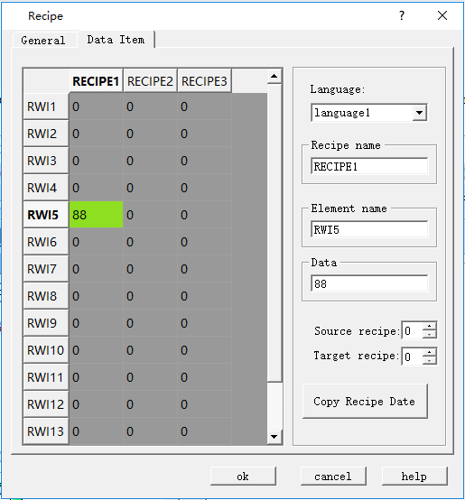
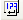
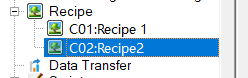
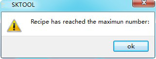
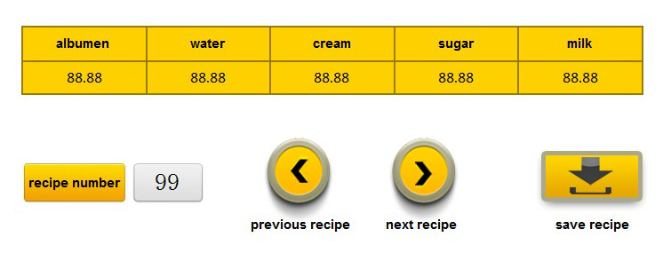
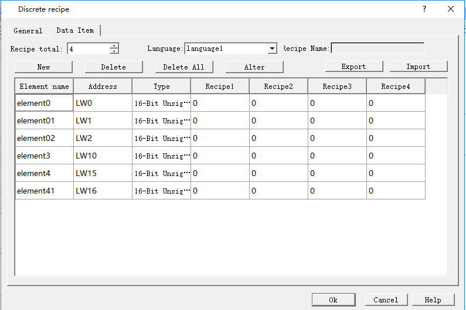
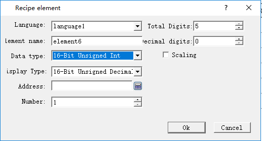

# Recipe

In the field of manufacturing, recipe is used to describe the proportions of materials used to produce a product, and is a set of parameter settings of variables used during production. For example, a basic recipe is necessary for bread making, and this recipe may list the weights or proportions of all materials used to make bread, such as water, flour, sugar, egg, oil, and so on. In addition, it may also list some optional materials such as fruit, nut, chocolate, and so on. These optional materials may be added to the basic recipe to make bread of different flavors. Take iron works for another example. A recipe in an iron works may be a set of machine parameters. For batch processing machines, a recipe may be used to describe different steps of the batch processing.

A machine may make both bread and cakes, including bread of different flavors and cakes of various forms. Here, we call the material proportions of bread as a recipe, and call the different material proportions of different flavors of bread as a file. Obviously, recipe records are contained in recipe files.

CommandHMI provides the function of recipe configuration that is available in the Recipe of the menu bar or in the Project Manager, you can enter the recipe configuration dialog box, add a new set of recipe functions. As shown in Figure 7-32:

Figure 7-32 Continuous recipe Property Settings Dialog Box

• Name: Name of the current recipe file.

• Description: Description: Name description of the current recipe file;

• Recipe length: Set the length and quantity of the recording address to be read by the current recipe. Addresses of recipe record form are arranged in sequence automatically by the system, and cannot be changed. The maximum length of recipe is 4096.

• Total Number: Number of recipes, up to 512;

• The current recipe group editable in HMI:Enable Edit the recipe in HMI.

Figure 7-33 Discrete recipe Property Settings Dialog Box

• Grouo name: Name of the current recipe file.

• Recipe description:Description: Name description of the current recipe file;

• Write recipe completion flag:after current recipe is wrote to PLC,the value of  bit address set 1;

• The current recipe group editable in HMI:Enable Edit the recipe in HMI.

Note: Recipe length \* Bytes occupied by data type \* Total number &lt;= 512KB

• Data Type: Data type of the data register;

• Write recipe to PLC: Set related data register address of recipe and PLC;

• Read recipe from PLC: Set related data register address of recipe and PLC;

• Recipe memory: The memory address range of the recipe in the HMI that is automatically generated and cannot be changed;

• Current recipe: The recipe memory address in the HMI and the data register of PLC is automatically generated by order and cannot be changed;

• Recipe Number Register: the recipe is arranged automatically by the order of serial number, and it cannot be changed; it corresponds the order of recipe name in the data item.

The continuous recipe data item, as shown in Figure 7-33:

Figure 7-34 Continuous Recipe Data Item Page

• Name: The name of the current recipe;

• Data: Write and display each address value of the current recipe;

• Copy Recipe Data: Copy the data from the source recipe to the destination recipe. Click OK to save the current one and click Cancel to exit the dialog box. Once the recipe configuration has been completed, the interface can be designed to operate the recipe in the HMI.

Application example of Recipe:

1\. Create a recipe configuration as described above. The effect is shown in Figure 7-34:

Figure 7-35  Function of continuous recipe data copy

This recipe has a total of 4 sub-recipes, each containing 16 items. The storage addresses are from RWI: 1 to RWI: 16 in the memory of HMI.

2. After the recipe configuration, display the recipe on the screen，modify it or directly download it to the PLC. So we will use the following essential functional controls.

• Recipe display: Click numeric display / input(refer to "Numerical display / input")

Select the internal memory address RWI: 0 to create a numerical display and input control on the screen. The input and display value is the recipe serial number. The value 0 of RWI0 means recipe serial number 1; the value 1 means recipe number 2 , etc.

• Click the function button: Refer to the "Function button" for operation.

Buttons can be created to write recipe to PLC, read recipe from PLC, save recipe, select the previous recipe and the later one through the function button with relevant function setting.

Application of multiple recipes: CommandHMI provides new function of multi-group recipe, but it supports only ten groups, otherwise a limit message will be prompted as shown in 7-34-2

Figure 7-35-1

Figure 7-35-2

The LW61141 is employed to enter the recipe group. The original RWI0 is also used to input the recipe number. Therefore, it needs to set values of LW61141 and RWI0 at the same time when select one. For example: Enter recipe group 0 to LW61141, serial number 2 for RWI0; it means selecting the recipe data of Recipe 2 in recipe group 0.

3. According to the above operation, a screen can be created as shown in Figure 7-35:

Assume that all monitor address to be written is D0, the length of the recipe is 16 and the total number is 4.

Figure 7-36 Effect of the Recipe

It is easily available to modify, preserve, read and write recipe through the function buttons and numerical display / input settings. But it should pay attention to the following points:

• Recipe list should be established before use of Recipe functions.

• When writing recipe parameters into the recipe list, pay attention to the data type. 16-bit datum occupies only one word, and 32-bit datum occupies two words. Consistent data type should be chosen. Particularly, pay special attention to use of 32-bit data address. As 32-bit datum occupies two words, prevent address overlapping when entering write-in address and monitored address.

• Address RWI0 is for fixed use, and can be used to change recipe number only. If value of RWI0 is 0, it indicates the first recipe number, and so on.

• Recipe parameter addresses are continuous.

The discrete recipe data item, as shown in Figure 7-33:

Figure7-41  Discrete recipe data item page

• Recipe total : Number of recipes, up to 128;

• Language:  Users can set different languages’ Element name and recipe name.

• Recipe name:Modify current recipe name,such as “recipe1”,”recipe2”.

• New:Pop up a “recipe element”dialog,create a element,as shown follow figure.

  

Figure7-42  Discrete recipe new element box

• Delete:delete current recipe element.

• Deleter All:Delete all element in this recipe.

• Alter:Pop up the current element’s Recipe element box,modify the information.

• Export:Pop up a save as dialog,save the recipe as a \*.csv file by assign root and name.

• Import::Pop up a open dialog,choose a \*.csv file as current recipe.
