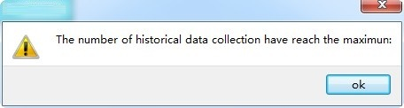
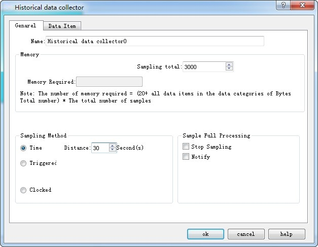
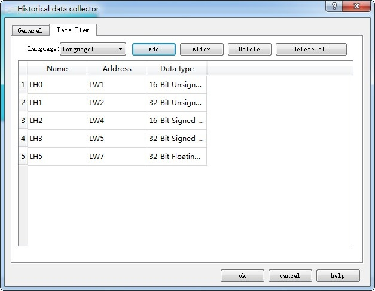

# Historical Data Collector

The Historical Data Collector functions in conjunction with the [Historical Data Display](../configuration-guide/extended-controls/history-record.md) on the toolbar. The former is mainly applied for parameter settings while the later is mainly to display the historical data.

Create a historical data collector by right clicking "Historical Data Collector" and select "New Historical Data Collector" in the pop-up menu.

Note: CommandHMI newly supports multiple sets of historical data; up to four historical data collectors can be built.

Note that you cannot create more than four sets; otherwise an error dialog box will pop up as follows:

Double click "Historical Data Collector 0" in "Project Manager" to open a dialog box as shown in Figure 7-19:

Figure 7-19     Historical Data Collector dialog box

• Name: Set the name displayed in the Project Manager.

• Sampling length: Number of data to be read each time from the memory.

• Total number of samples: Times of extracting data.

Note: The memory required = (20 + total bytes of data types occupied by all data items) \* total number of samples.

"20" refers to the bytes occupied by time and date;

“Total bytes of data types occupied by all data items” refers to the sum of the data types selected for each item on the Data Items page.

For example, as shown in Figure 7-20:

a, if the data type of each item is "16-bit positive integer", then "total bytes of data types occupied by all data items " = 2 +2 +2 +2 +2; that "all data items (20 + 10) \* 2, which is equal to 60; the bytes number of "16-bit data " is 2 while "32-bit data occupies 4 bytes.

b\. If the data type selected for "LH1" and "LH3" is "32-bit positive integer" (when the data type selected for "LH1" and "LH3" is "32-bit positive integer", the address of the "Data item" displays as LH0, LH1, LH3, LH5, LH6), then "the total number of bytes occupied by all data items" = 2 + 4 + 4 + 2 + 2= 14; then the required memory = (20 + 14) \* 2= 68.

Read Address: Start address to read data (Refer to Data Item for detailed information)

Sampling method:

• Timing: Read data at set interval.

• Trigger: Read data when the value of the trigger address is 1.

• Clock: Start reading data at a user-set time interval.

Full sampling disposal manner: Disposal when the data sampling reaches the maximum total number.

Stop sampling: Stop data sampling in case of full sampling; if this option is not selected, the new read data will replace the oldest one.

Notify: Inform an address whose value is 1 when the sampling number reaches the maximum.

Click the "Data Item" tab, set the page properties, as shown in Figure 7-20:

Figure 7-20 Data Item of Historical Data Collector

If multi-language is selected, it is necessary to set names for each language when adding new data items; otherwise it cannot add new items.

In CommandHMI, the address of each group of historical data can be set discrete, according to the actual situation of LW register, for example: S1 is LW1, S2 is LW89, S3 is LW8905.

Click on any item in the list box to set the properties.

An example in detail:

Set the read address to LW1 on the General page, the register address is set consecutively and the sampling length is 5; click the Data Item tab and add 5 columns of data (LH0-LH4) in the list. Select each to set the properties such as name, address, data type, total digits decimal places and whether to scale.

Assuming that the names, data type and scaling of LH0-LH4 are set as shown in Figure 7-20; other attributes are default values:

LH0-16 bit Positive integer, Scaling, with a gain of 3 and an offset of 2

LH1-32 bit positive integer, Scaling, with a gain of 2 and an offset of 1

LH2-16-bit integer, Scaling is not selected

LH3-32-bit integers, Scaling is not selected

LH4-Floating point, Scaling, with a gain of 4 and an offset of 5

After the settings, since the sample length is 5 (set in General page), it reads out 5 address values consecutively starting with "Read Address". Addresses are read according to the data type of each item.

If select 16-bit data, the extracted address is continuous. If 32-bit data is selected, the fetched addresses are separated. If the scaling function is selected, the final read value is equal to the value of read address multiplied by the gain plus the offset.

Note: The gain value in scaling must be greater than 1!

Set up each data type and whether to scale; the addresses to be read are as follows:

LH0-LW1 (16-bit data, read address + 1) Final value of LH0 = Address value of LW1 × 3 + 2

LH1-LW2 (32-bit data, read address +2) Final value of LH1 = Address value of LW2 × 2 + 1

LH2-LW4 (16-bit data, read address +1) Final value of LH2 = Address value of LW4

LH3-LW5 (32-bit data, read address +2) Final value of LH3 = Address value of LW5

LH4-LW7 (32-bit data, read address +2) Final value of LH4 = Address value of LW7 × 4 + 5

After settings, click "OK". Click "Historical data display" icon on the toolbar; set the row number to 5 in the pop-up dialog box, the other attribute values are by default.

Click "OK" to generate a table automatically in the screen, as shown in Figure 7-21:

Figure 7-21 Data Table of Historical Data Display

Application of the above table:

• Date: The date on which the address value is read

• Time: The time when to read the address value

• "LH0": Display the value of the LW1 at a certain time.

• "LH1": Display the value of the LW2 at a certain time.

• "LH2": Display the value of the LW4 at a certain time.

• "LH3": Display the value of the LW5 address at a certain time.

• "LH4": Display the value of the LW7 address at a certain time.

For example, the read address is LW1, the user-defined data sampling length is 3, the total number of samples is 10, the sampling method is Trigger, the time interval is 1 second, and the data type of each data is the default;

1). The option of Stop Sampling is not selected:

The LW1, LW2, LW3 address values are read every 1 second. Since the total number of samples is 10, 10 sets of data are read out at the tenth second. Because the "Stop sampling" option is not selected, the process continues. A fixed memory area depending on the sampling length, total number of samplings and data type is allocated to store the read data, so when the number of data groups has reached the "total number of samplings," the latest read data will replace the first one.

2). The option of Stop Sampling option is selected:

The only difference is that it stops sampling when achieve the total number of samplings.

Employ “[Historical Trends](../configuration-guide/extended-controls/histrendgraphics.md)”or “[Historical Data Display](../configuration-guide/extended-controls/history-record.md)”to read the values more intuitively.
