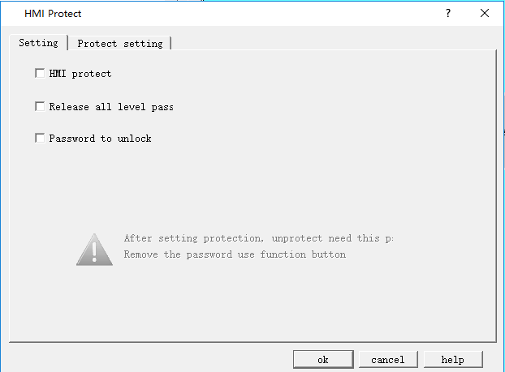
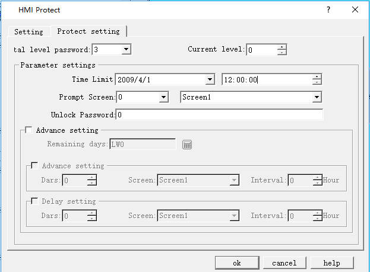

# HMI Protection

HMI protection is mainly employed to set a certain period of time during which HMI can functions normally. If the time is beyond the set period, HMI will jump to a specify screen where a password is necessary to re-use the HMI.

Double click the "HMI protection" option in the "Project Manager" to pop up dialog box shown in Figure 7-14:

Figure 7-14    HMI Protection dialog box

Example to illustrate the application of this function:

➢Select "Password to unlock": A password is required to enter the HMI protection the next time.

➢Select "Release all level pass":If input this password when unlocking HMI protect,it would release all the HMI protect level.

➢Select "HMI Protect":automatically go to “Protect setting”page,as shown follow:

Figure 7-15    HMI Protection Setting

Set the "Total level password" to 3; select the 1 button icon, choose 2009-04-01 and 12-00-00 in the Time Limit column under the "Parameter settings"; decide the screen 1 as the "Prompt Screen"; Set "Password to unlock" to 1111. Then the level 1 protection is set up.

As in the above case, set the time limits and passwords for level 2 and level 3.

• removes all ranks

After enabling this feature and setting the password, the password set at this location can remove all levels of the HMI protection setting

•  startup password protection

After enabling this function and setting the password, you need to input this password to turn on HMI protection the next time to view HMI protection information

•  enable password protection

Enabling this feature will enable HMI protection.The specific information is set in the protection Settings.

• protection Settings

Total password level: up to 15 levels of HMI protection for different periods of time as required

Current password level: the following parameters are set for the current password level

Parameter Settings:

Term of use: HMI protection expiry date

Deadline prompt screen: prompt screen when HMI protection expires

Unprotect password: the password that is unprotected by HMI when it expires

Advanced Settings:

View the remaining days: see the remaining days that are now up to the HMI protection set lifetime

In advance:

Set the distance between the remaining set days of HMI protection service life and the HMI protection service life

Delay:

After setting the HMI protection service life to set the number of days, the interval specified time prompts the specified screen

Advance and delay priorities

Advance selection, delayed selection, effective in advance

No selection in advance, delay selection, delay effective

Advance selection, delay selection, function button HMI protection delay unlock is not used, it is effective in advance

Advance selection, delay selection, function button HMI protection delay unlock, delay effective

•  illustrates the function of the method of use:

Suppose the total number of password levels we set in this dialog is 3;After that, select 0 in "current password level". In "parameter setting", select the date of use in the "usage period" column. Suppose to select 2009/04/01 here.Enter the usage time in the next column, assuming the option is 12:00:00;Select the screen when the deadline arrives in the "deadline prompt screen" option, assuming that it is screen 1;Enter the password needed to unprotect the password when "unprotect password", assuming 1111.Level 1 HMI protection setup completed.

again, at the level of the "current password" selected 1, inside the "parameter setting", in the "service life" column choose to use date, suppose in the choose the 2009-04-05;Enter the usage time in the next column, and suppose to select 12-00-00;Select the screen when the deadline arrives in the "deadline prompt screen" option, assuming that it is screen 2;Enter the password needed to unprotect the password when "unprotect password". Suppose it is 2222.Level 2 HMI protection setup completed.

again, at the level of the "current password" selected 2, inside the "parameter setting", the "service life" column choose to use date, suppose in the choose the 2009-04-10;Enter the usage time in the next column, and suppose to select 12-00-00;Select the screen of time limit prompt screen in the option of "deadline prompt screen", and suppose it is picture 3.Enter the secret required to unlock the password protection when "unprotect password", assuming 3333.Level 3 HMI protection setup completed.

3 HMI protection Settings after click "ok" button.

Suppose today's date is 2009-04-01, the time is 08-00-00, because the use period of level 1 HMI protection set before this time is 12-00-00 of 2009-04-01. Since the deadline has not arrived, this HMI can still be used normally.Suppose after 4 hours, the time is 12-00-00 of 2009-04-01. At this time, HMI will automatically jump to the screen set by the user for this period.The user wants to continue to use the HMI, to HMI to can operate on other images, the user can in the picture (picture 1) add a function button and select "remove HMI lock" function in the button, when the level 1 HMI protection using the time to use, click the function button, and input the password in the pop-up box input level 1 password protection solution, in this input 1111 can remove password protection.

When level 1 HMI password is unblocked, HMI can be used normally.Hypothesis for a period of time, the time is 12 2009-04-05-00-00, because now it's time to set the level 2 HMI protection, so the HMI automatically adjust to the HMI set protection screen (picture 2), by the same token, the user need to use the function button and select the "cancel the HMI lock" function button function, input level 2 password protection (2222), HMI can normal use.

Because we set level 3 HMI protection here, similarly, when the time is 12-00-00 of 2009-04-10, the user needs to use the function button and select the "unlocking HMI" function in the function button. Enter the level 3 unlocking protection password (3333), and HMI can be used normally.

HMI protection fails when all level 3 passwords are unblocked.HMI can be used normally.

The above examples illustrate the use of HMI protection function. For setting different password levels, the operation is similar. Users can refer to the above.
