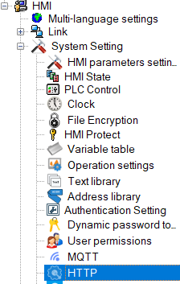
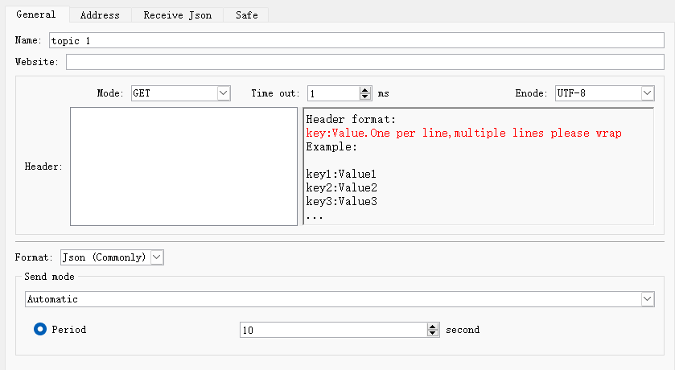
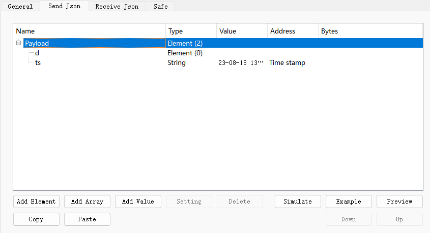
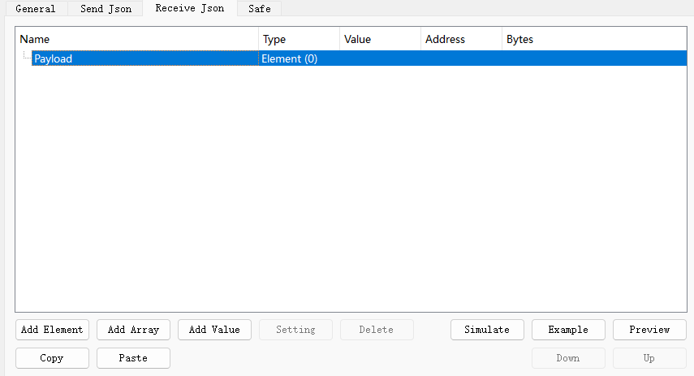

# HTTP

 Only the remote screen supports this function

With this function, users can easily configure HTTP server parameters

Ø  general page

- Name

Connection name

- URL

The destination URL of the HTTP request

- Method

HTTP request method: GET or POST

- Encoding

Encoding format

- Request Header

HTTP Request Header

- Timeout

HTTP response time

- Formats

include: JOSN (general) or JSON (advanced), [same as 【MQTT】](mqtttheme.md#anchor-name)

- Transmission modes

include: automatic and bit triggered

Ø  Address page (JSON generic)

It can be set when \[JSON General\] is selected as the format on the \[General\] page.

Add a value. Bit or word type can be set, it can be a fixed value or read data from a specified address. [Refer to 【MQTT】](mqtttheme.md#anchor-name1)

Ø  Send JSON page (JSON advanced)

It can be set when \[JSON Advanced\] is selected as the format on the \[General\] page.

Set the sending data, address setting supports tree structure, can use components, arrays and other forms, time stamp and data name can also be customized. [Refer to 【MQTT】](mqtttheme.md#anchor-name1)

Ø  Receive JSON page

Set receiving data, address setting supports tree structure, can use components, arrays and other forms, time stamp and data name can also be customized. Can refer to [【Send JSON】](#anchor-name)

Ø  security page

You can refer to the \[Security\] page in [\[MQTT\].](mqtttheme.md#anchor-name2)
