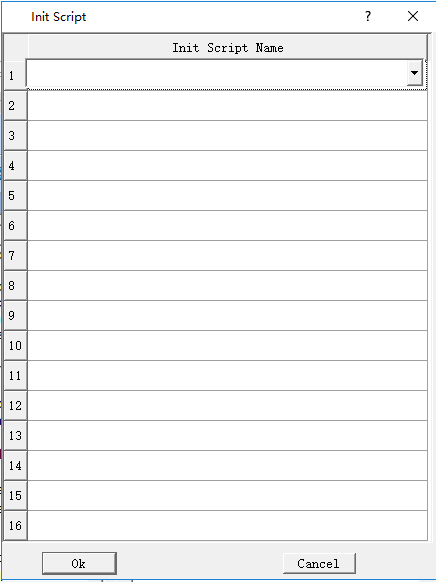

# Init Script

Set a script that has been successfully compiled into an Init script, meaning executing this script only one time without being limited by screens. A maximum of 64 init scripts can be added, and they are executed in the set order.

Click "Init Script " on the menu "Setting", as shown in the dialog box:

Click the list item to list all the script names that have been compiled successfully. The selected script is executed as a init macro during configuration run time.
