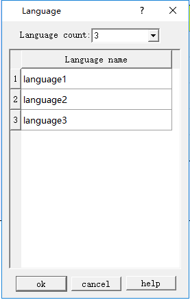
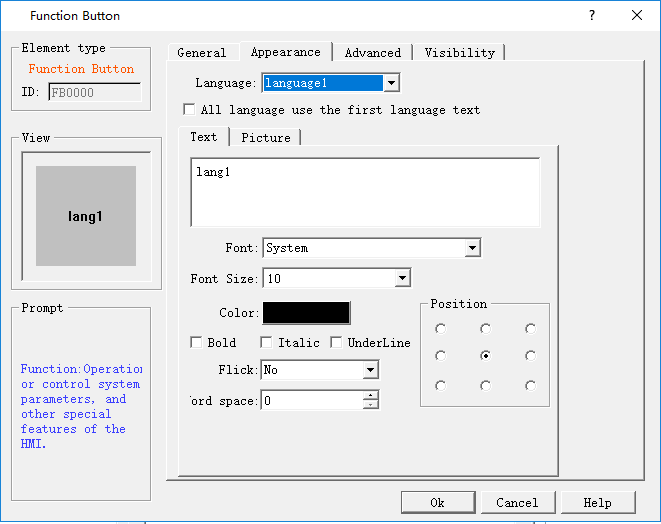
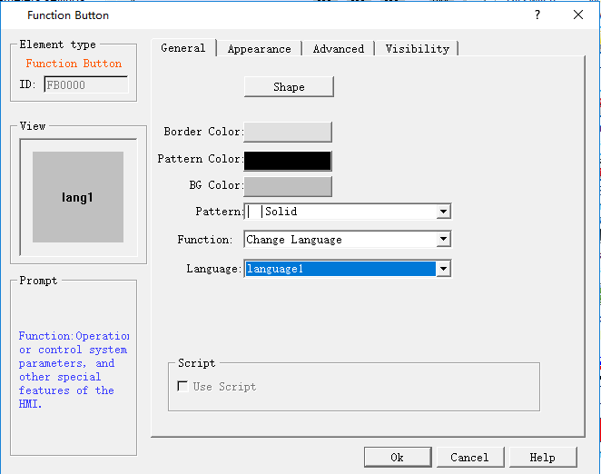
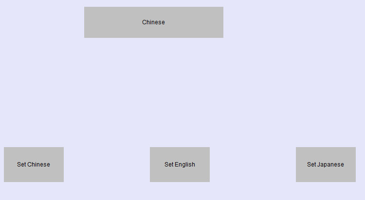
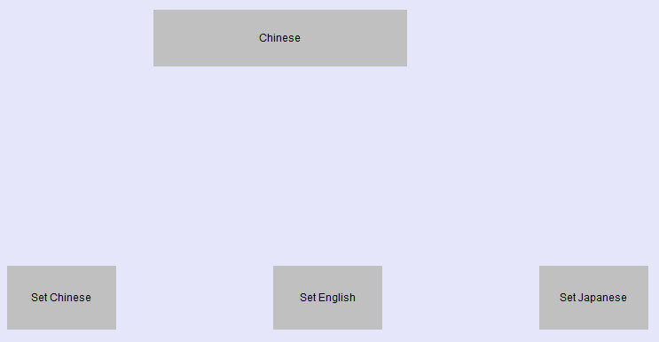
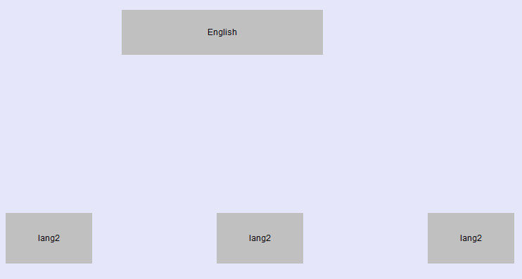
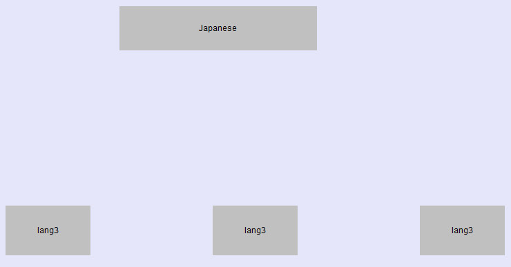

# Language

Language: This function realize multiple languages; it is necessary to preserve languages employed in configuration in character library of PC.

Double click the Language option or right click to open the dialog box of Language Setting.

Language total: Set total number of the system language, at most fifty languages. Article 50 the biggest

Language Name: Set a name for each language.

Example:

1\. As shown above, set the total number of languages to 3, and the language name is by default; create a new text input control, such as Screen button, select Language 1 in the language drop-down box, enter in the text box “lang1”, and then set the parameters of font size and color, etc.;  select Language 2 in the language drop-down box, then enter “lang2”; select Language 3 in the language drop-down box, then enter in the text box "lang3", as shown below:

2\. Click "OK" after the settings, and then left click on the screen to add this Screen control button when the mouse cursor shows a cross shape; adjust its size. It should note that "Function" options below “General” page of each button are the same:  "Switch language"; while options of "Language" are different: Language1, Language2 and Language3, respectively.

3\. Save the project after the settings, as shown below:

4\. Simulate (or download to HMI)

All controls with text will be presented in the according language when click Function button 1, 2 or 3.

As shown below:

The figure above shows the state after clicking Function button 1 to switch the language to Language 1.

The figure above shows the state after clicking Function button 2 to switch the language to Language 2.

The figure above shows the state after clicking Function button 3 to switch the language to Language 3.

To achieve the multi-language function in the entire project, it is necessary to input different texts for each control or object with text (same operation with the first point). This enables the entire project to be switched to the specified language when execute the command of "Switch Language".
