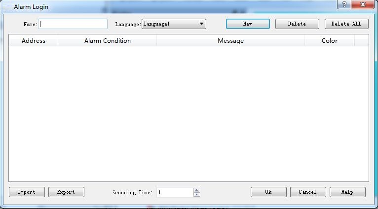
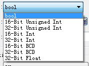
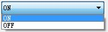
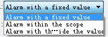
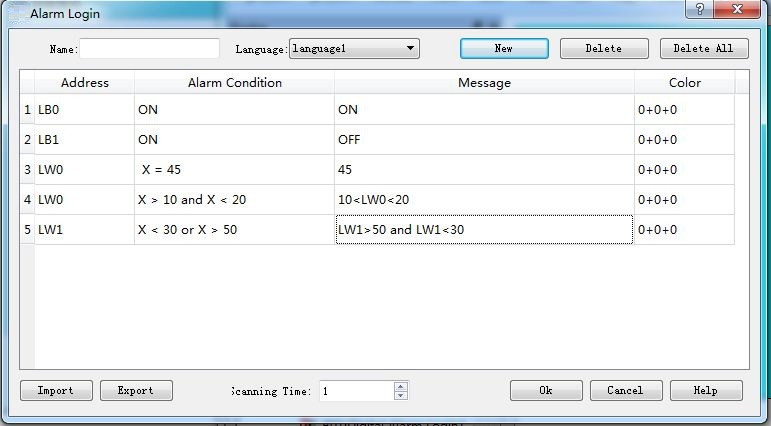

# Discrete alarm login

In the expansion of the alarm login options, double-click the "new discrete alarm login" option, you can open the discrete alarm settings dialog box

• New: a new alarm content, data categories can be freely selected

• Delete: delete an alarm content

• Delete all: delete all alerts

• Export: set up a good alarm content

• Import: import and set up the alarm content

New alarm setting screen:

• Data categories: according to the need to choose the appropriate data categories to determine the alarm conditions

• Address: set the address that needs to be monitored and alarm

• The number of consecutive: according to the need to set whether the need for continuous N address monitoring

• Alarm information: the alarm information displayed when the address value is set to alarm condition

• Alarm condition: set the alarm condition of the address value, and the alarm condition is shown below:

• L bit ON alarm: when the data category is bool, the address is ON trigger alarm

• L bit OFF alarm: when the data category is bool, the address is OFF trigger alarm

• L fixed value alarm: when the address value is set value, the alarm is triggered

• L range alarm: when the address value is within the set range to trigger alarm

• L out of range alarm: when the address value is not within the set range, the alarm is triggered

• Alarm color: set the address value to trigger the alarm is the color of the alarm information

Analog alarm number: at present, HM series HMI can only set up 2 analog alarm
