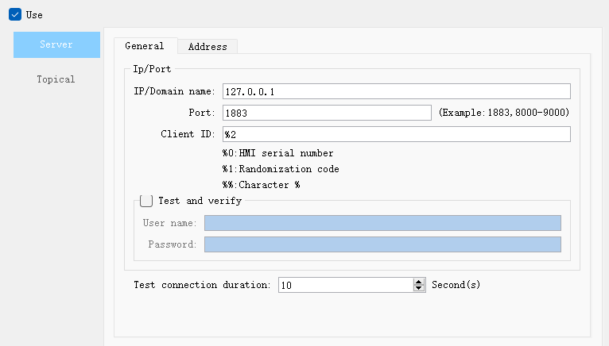
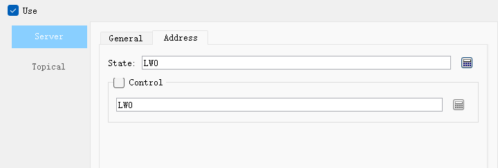

# Server

• **General Page**

- IP(domain name)

MQTT server IP

- Port

MQTT server port number

- Client ID

Client ID, you can use specified special characters

- Username

Set username (requires authentication to be enabled)

- Password

Set user password (requires authentication to be enabled)

- Test connection duration

When When the MQTT server exceeds this setting value and still does not receive the test message from the HMI, it will be considered that the HMI is disconnected.

• **Address Page**

- Status address

Set a group of font addresses to check the connection status.

**\[status address\](status indication)**

When the value is 0, stop the online server.

When the value is 1, it is disconnected from the server.

When the value is 2, the connection to the server is successful.

**■   \[state address + 1\](error indication)**

|                      |                                                                                                                                                                                                                                                                                             |
|----------------------|---------------------------------------------------------------------------------------------------------------------------------------------------------------------------------------------------------------------------------------------------------------------------------------------|
| **Indicative value** | **Description**                                                                                                                                                                                                                                                                             |
| 0                    | The operation completed successfully                                                                                                                                                                                                                                                        |
| -1                   | MQTT client operation failed                                                                                                                                                                                                                                                                |
| -2                   | Persistent errors                                                                                                                                                                                                                                                                           |
| -3                   | Client disconnected                                                                                                                                                                                                                                                                         |
| -4                   | The maximum number of messages allowed at the same time has reached the upper limit                                                                                                                                                                                                         |
| -5                   | Invalid UTF-8 string detected                                                                                                                                                                                                                                                               |
| -6                   | An invalid empty parameter was supplied                                                                                                                                                                                                                                                     |
| -7                   | The subject has been truncated (the subject string includes embedded NULL characters), use the subject length value to access the full subject                                                                                                                                              |
| -8                   | The structure parameter does not have the correct eye catcher and version number                                                                                                                                                                                                            |
| -9                   | The qos parameter is not 0, 1 or 2                                                                                                                                                                                                                                                          |
| -10                  | All 65535 MQTT msgids are in use                                                                                                                                                                                                                                                            |
| -11                  | The request is not complete and is being discarded                                                                                                                                                                                                                                          |
| -12                  | Cannot buffer more messages                                                                                                                                                                                                                                                                 |
| -13                  | Try to use the non-SSL version of the library for an SSL connection                                                                                                                                                                                                                         |
| -14                  | The protocol prefix in the serverURI should be: tcp:// or mqtt:// (insecure TCP), ssl:// or mqtts:// (encrypted SSL/TLS), ws:// (insecure WebSockets) or wss:// (secure WebSockets). TLS enabled prefixes (ssl, mqtts, wss) that are only valid if the TLS version of the library is linked |
| -15                  | Do not use other versions of the MQTT option                                                                                                                                                                                                                                                |
| -16                  | The call does not apply to the MQTT version of the client                                                                                                                                                                                                                                   |
| -17                  | Will subject length is zero                                                                                                                                                                                                                                                                 |
| -18                  | The connect or disconnect command is ignored because there is already a connect or disconnect command at the head of the pending list. Use onSuccess/onFailure callbacks to wait for previous connect or disconnect commands to complete                                                    |
| -19                  | maxBufferedMessages in connection options must be &gt;=0                                                                                                                                                                                                                                      |

- Control address

**The register data type is a 16-bit integer.**

When the value is less than or equal to 0, disconnect from the MQTT server.

When the value is greater than 0, keep connecting with the MQTT server.
