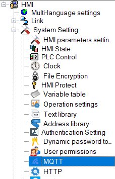

# MQTT

 Only the remote screen supports this function

With this function, users can easily configure MQTT server parameters and customize subscription/publishing topics

**The content is as follows:**

• [Server Settings](mqtt.md)

• [theme settings](mqtttheme.md)
