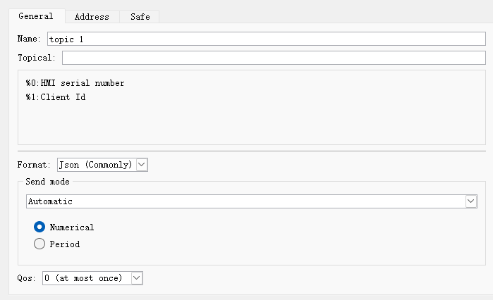
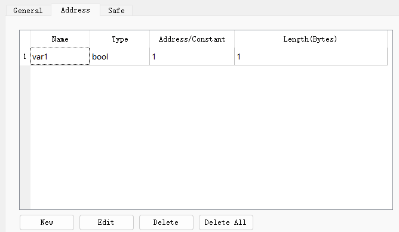
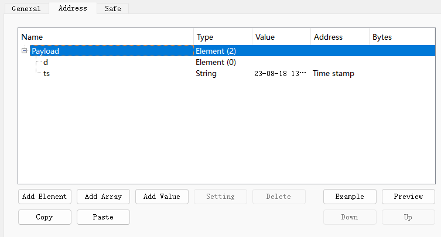
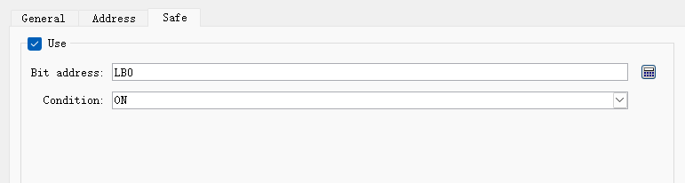
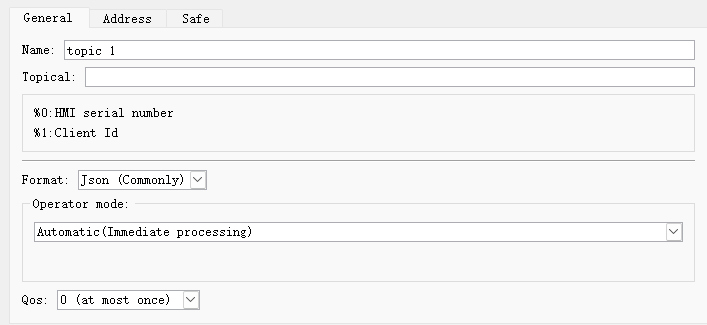

# Theme

Ø  add post topic

• general page

- Name

Set the project name of the MQTT topic

- Topic

When sending a message, the topic received by the MQTT server

- Format

\[JSON (General)\]: The data is in JSON format with list structure.

\[JSON (advanced)\]: JSON format that can flexibly customize the tree structure.

- Send mode

**■  automatic**

Value change method: When the content of the monitoring address changes, it will be automatically transmitted.

Cycle change method: The content of the monitoring address will be transmitted periodically.

**■  bit trigger**

When specifying a bit address is triggered, the content is transmitted.

• Address (JSON general)

It can be set when \[JSON General\] is selected as the format on the \[General\] page.

Add a value. Bit or word type can be set, it can be a fixed value or read data from a specified address.

• Address (JSON Advanced)

It can be set when \[JSON Advanced\] is selected as the format on the \[General\] page.

The address setting supports a tree structure, which can be in the form of components, arrays, etc., and the time stamp and data name can also be customized.

- element

Add a data element. A component can contain multiple data formats, and each data format has its own name and value.

The data of the element is enclosed in braces { }.

- Array

Add a data array. Arrays can contain multiple data formats, but only have one name.

Component data is enclosed in square brackets \[ \].

- value

Add a value, string or timestamp. When it is a value or a string, it can be a fixed value or read data from a specified address.

- template

Convert from user-edited custom JSON text to tree data

- Preview

Convert the current tree data into JSON text

• Security Page

After enabled, it takes effect when the set bit address meets the trigger condition.

Ø  Add subscription topic

• General page

- Name

Set the project name of the MQTT topic

- Topic

Topic subscribed from MQTT server

- The format is

[same as【Publish】](#anchor-name)

- Operation mode

■  automatic

automatically.

■  Manual

Manually set the specified address to execute.

• Address page

[Same as【Publish】](#anchor-name)

• Security Page

[Same as【Publish】](#anchor-name)
