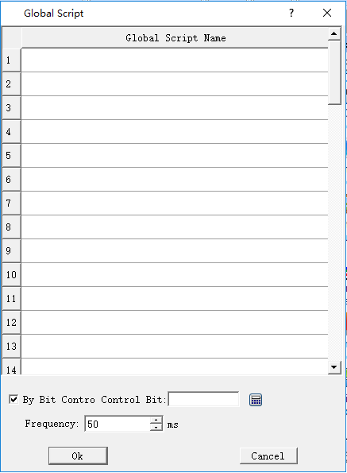

# Global Script

Set a script that has been successfully compiled into a global script, meaning executing this script when the configuration starts running, and it will be executed during the run time without being limited by screens. A maximum of 64 global scripts can be added, and they are executed in the set order.

Click "Global Script " on the menu "Settings", as shown in the dialog box:

Click the list item to list all the script names that have been compiled successfully, and then decide whether the script is controlled by bit and the execution frequency. The selected script is executed as a global script during configuration run time.
