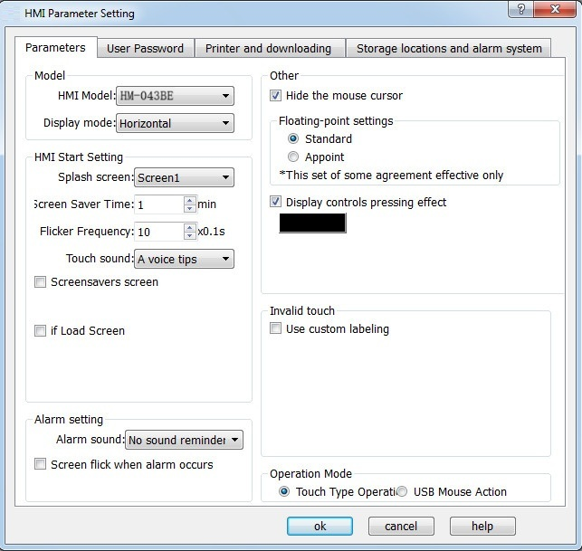
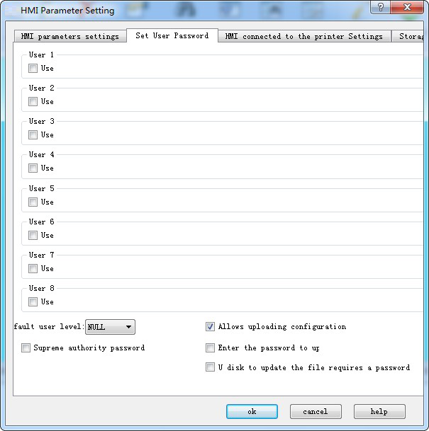
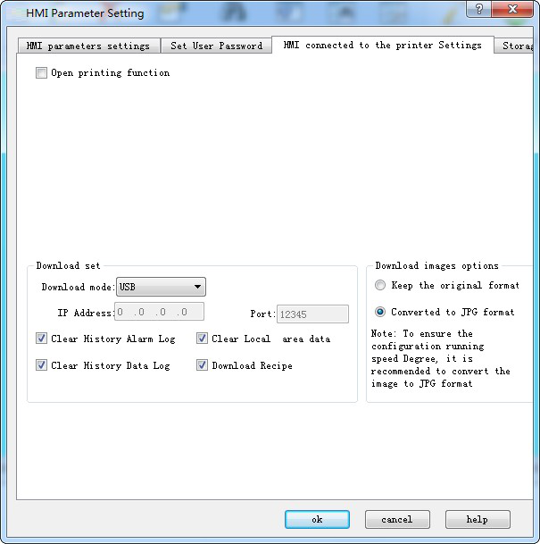
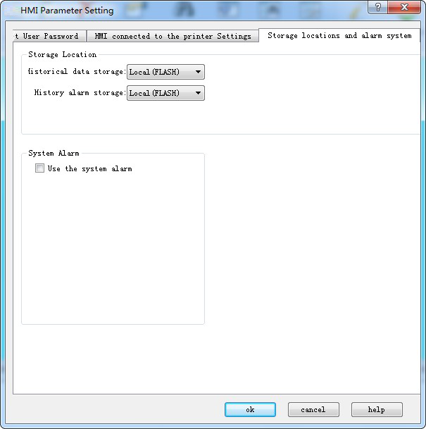
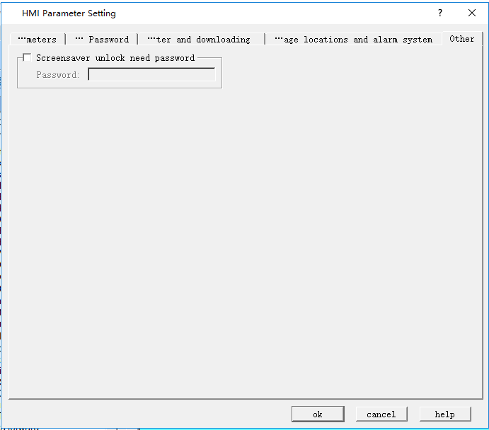

# HMI parameter settings

HMI model can be assigned when create a project or be modified during the configuration through HMI parameter settings in the Project Manager.

Double click “HMI Parameter Setting: in the Project Manager, then a dialog box pops up, as shown in Figure 7-3:

**Parameter Setting:**

1\. You can modify the parameter settings through Preference Setting in the drop-down menu Settings, or double-click the HMI Parameter Settings in Setting, Project Manager. Then a pop-up dialog box is shown as Figure 7-3 below:

Figure7-3 HMI Parameter Setting dialog box

HMI Model: Change model of HMI

Model instruction:

E.g.: HM-043BE

HM: CommandHMI HM series

043: Display size of HMI

BE: B Type; there is also E type; different types have different resolution.

Display mode: Adjust horizontal or vertical display screen.

HMI Start Setting

Splash screen: The start screen of HMI when powered on

Screen Saver Time: Set screensaver time

Flicker Frequency: Set the flicker frequency of objects or controls which can blink; you can change the speed of flicker by inputting directly a value and clicking the spin button.

Alarm sound: When the alarm occurs, the touch screen can remind users through sound; the right drop-down menu contains two cases, with or without sound reminder.

Touch sound: Options in the right drop-down menu can decide Sound reminder or No sound reminder.

Screensavers screen: Select a screen among the existing screens as screensaver screen; just touch the screen to return the former screen.

If Load Screen: If choose this option, the HMI will display the selected loading screen after power-on for a certain while, and then switch to the splash screen; thus users can give some tips or notes.

Screen flicker in case of alarm: switch background colors between that of Alarm control or Alarm Bar and screen background color; flicker frequency is in accordance with the above. This function doesn’t work when the background is a picture or the background pattern is transparent.

• Other settings

• Hide mouse cursor: Whether to display the mouse

• Floating-point settings:

• \[Standard\]: High byte floating point ahead while the low one behind;

• \[Appoint\]: users determine the order.

• Invalid touch: Select the "Use custom labeling", which means touchable controls cannot be touched, then the picture marking the control chosen by user is untouchable.

• Operation Mode: Choose one mode between traditional touch operation and USB mouse operation.

• Display controls pressing effect: CommandHMI is newly added pressing effect display. When the pressing effect is applied, rectangular pressing trace will appear if users touch the control. The pressing trace color depends on user’s preference. Currently Bit switch, Word switch, Screen button, Function button, Numeric input and ASCII input controls support this effect. The default is No effect.

Note: Pressing effect of elliptical controls is still a rectangle.

2、Set user password:

Figure 7-4      Set User Password

• This function supports 8 sets of user password, each of which has eight levels of password for users to choose.

• The default user level: The current default user class is NULL.

• Allow uploading configuration: If select this option, you can upload the project from HMI to PC; otherwise it cannot be uploaded.

• Enter the password when uploading: Whether uploading projects requires a password.

• Password when updating configuration through U disk: The password set up, the password is necessary when you update the HMI configuration projects through U disk.

• Supreme authority password: This password can operate all controls limited by grades.

• Upload: Whether this password enables upload configuration projects from HMI to PC.

• Permissions: Whether this password can perform all limiting operations.

3、**Settings of connection to the printer and downloading**

Click "Settings of connection between HMI and printer" button, as shown in Figure 7-5:

Figure 7-5      parameter settings of connection between the printer and the HMI

This page contains parameter settings of connection between the printer and the HMI; users can select corresponding parameters according to printer models.

Download settings:

Download mode: Users need to select USB or Ethernet connection to download. If choose the Ethernet, it’s necessary to set the IP address and port number (IP address and port number are those of the HMI).

Clear historical alarm records: Whether to clear the history alarm information before downloading.

Clear historical data records: Whether to clear the history data information before downloading.

Download Formula: Whether to download formulas in the current project to the HMI.

Image Downloading Options:

Keep the original format: Selecting this option means retain the image format unchanged when downloading.

Convert to JPG format: Convert all images to JPG format before downloading them into HMI.

(Note: Due to the larger space occupied by BMP format images, it’s suggested to select this option.)

**4. Storage location and alarm system, as shown below**

Figure 7-6      Storage location and Alarm system

• Storage location: Location for historical data, historical alarm and screen shots. Provide "Local (FLASH)", "U disk"   three options for users to choose according to their need. The default is Local (FLASH).

• Alarm system

• Use the alarm system: Whether to use the system alarm. When an alarm occurs, the alarm system displays the current alarm information at the top or bottom of each screen according to the options set by users.

• Alarm background color, Text color, Font and Font size, these are attributes options of the alarm display system. Users can set these options as needed.

• Way of display: "Always display" refers to the alarm displayed all the time; "Cyclic display" means that alarm display or disappear within a certain period to achieve the flicker effect.

• Position of alarm bar: Choose the position where the alarm bar appears.

**5. Other, as shown below**

Figure 7-6      Screensaver unlock password

Use the Screensaver unlock password,when unlocking screensaver,need to input the correct password as the edit.

Note: Change of the screen saver time is not valid until "Screensaver screen" is chosen; just touch the screen of screensaver to return to the former screen.
