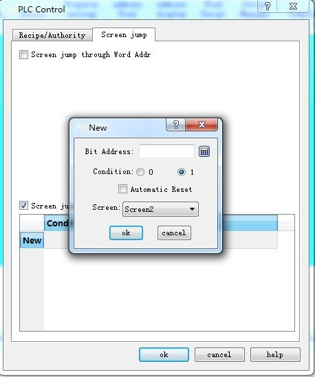
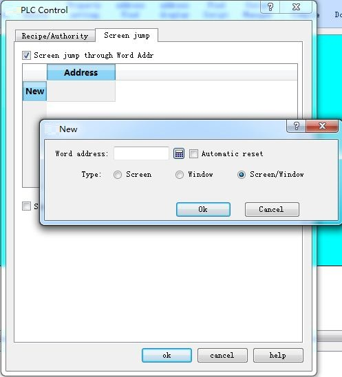

# PLC Control

PLC control means realizing operations of screen switching, change user level, change formula and write formula through PLC. Double click "PLC Control" in the "Project Manager", the dialog box shown in Figure 7-8 will pop up:

Figure 7-8      PLC control dialog box

• Change formula: HMI changes the formula according to its address value.

• Write formula: HMI controls the write of the formula based on its address value.

• Current user level: HMI controls the current user level according to this address value.

• Screen switch through Word address: Control screen switch through the word address. HMI switches the screen according to this word address value; if the address value is n, it jumps to the nth screen.

• Screen switch through Bit address: Double click the "New" line; a pop-up dialog box will appear as shown in Figure 7-9:

New bit control panel:

New word control screen

Screen: PLC word control can only jump between pictures

Windows: PLC word control can only jump between windows

Screen / window: PLC character control jumps between picture and window

Note: When switch screens through PLC, the value read for the first time does not affect the screen switching. It functions only when the value of PLC register is different from the first read value.
