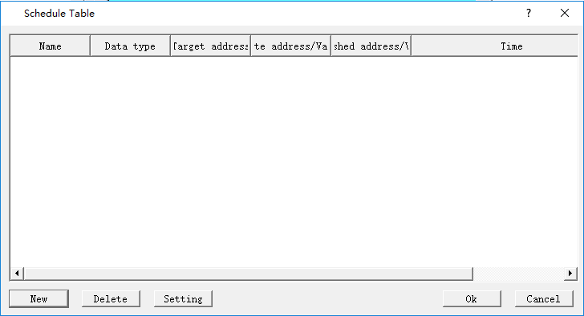
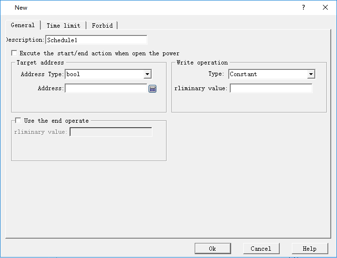
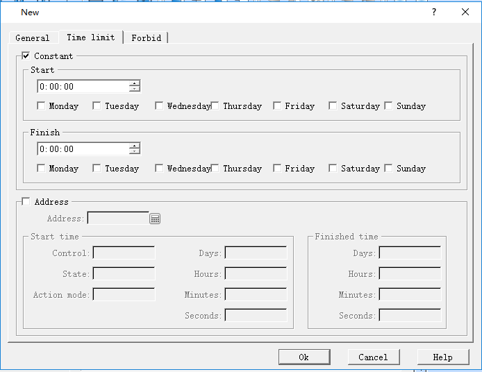
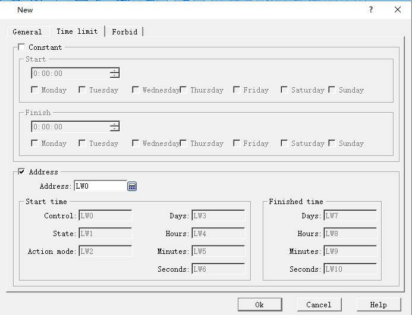
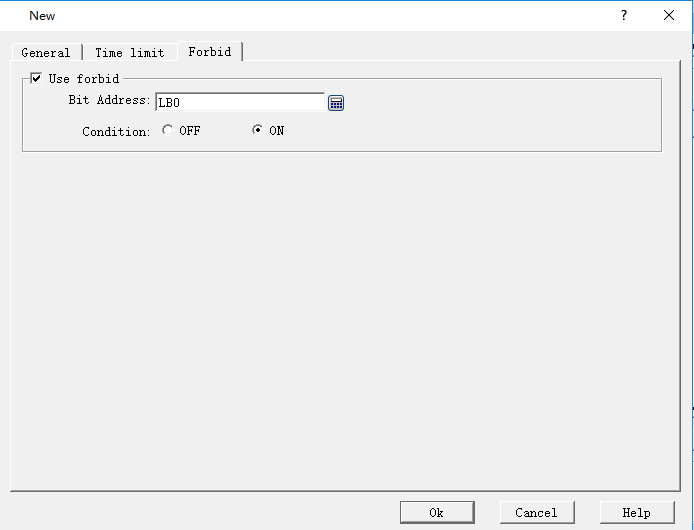
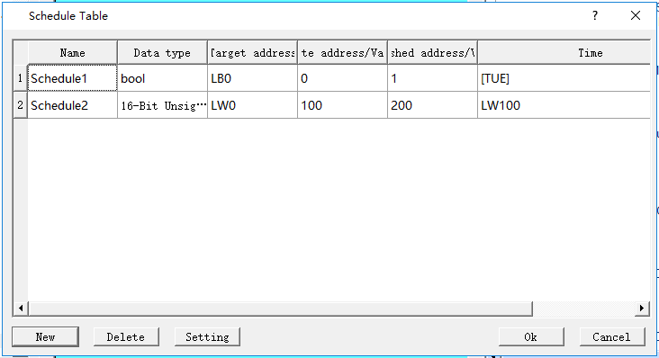

# Schedule Table

User can project some events according to the setting of schedule table.For example,a factory starts machines at 8:00 am,and closes machines at 18:00pm on weekday.

Click “Schedule Table”on “Standard List”，it will pop up a schedule table dialog,as shown follow.

 Figure 7-49 Schedule table dialog

Click”New”button,pop up a new dialog,as shown follow.The General page is first display.

  Figure 7-50 New schedule table dialog

• Description：

Input text here in order to convenient for users to understand this schedule table’s function.

• Execute the start/end action when open the power：

If the power（HMI）open time is after the start time，Execute the start/end action.

• Target address：

Input the target address type and address，the value of address will be wrote when the start/end time occurs.

• Write operation：

Type include “Constant”and”Address”.Below “Constant” type corresponds to Value that be wrote to target address.Below “Address”type corresponds to a address edit,the value of address will be wrote to target address value when start/end time occurs.

• Use the end operate：

If this section is selection，the value of write operation will be wrote in target address when end time occurs.

 After setting General,Click”Time limit”page, as shown follow.

  Figure 7-51 Time limit page

• constant： Check the Start/Finish time，when the tomes occur，it will operate the relevant write-in。

• Address：Using a piece of address to control the schedule table’s start and end time,as shown follow。

 

 Figure 7-52 Setting address control

For example ,the address set to LW0，LW0~LW10 are used to schedule address.

LW0:Control address，when LW0 == 1，the schedule time is loaded on HMI.Schedule element starts work.After Loaded on,LW0 was reset to 0；

LW1:Schedule state，when schedule time is loaded(LW0==0),LW1 would be set to 1。

LW2:Action mode，when LW2 is set to 1, if current time is after the start time,operate the write action。If LW2 is 0,when current time equals the start/end time,it will operate start/end operation.

LW3:the value indicates the day of start time，it’s value equal to 2^(number of week),LW3 = (0,1,4,8,16,32,64)

LW4~LW6:the start time’s hours,minute,seconds.

LW7:the value indicates the day of finished time，it’s value equal to 2^(number of week),LW3 = (0,1,4,8,16,32,64)

LW8~LW10:the finished time’s hours,minute,seconds.

Analogous，when LWn is set to control address，LWn~LWn+10 are used to schedule address，just like above。

**Tips:**If checked Address,Don’t foget to set the control address to 1 in order to loadthe schedule after set the start/finished time.Otherwise,the schedule wouldn’t work.

Fobid page,as shown follow：

 Figure 7-53 Forbid page

If check “use forbid”,when the bit address suit the condition(0 or 1),schedule can work.

After setting new dialog parameter,click “ok”,create a element of schedule table,as shown follow.

  Figure 7-50 Created schedule table
