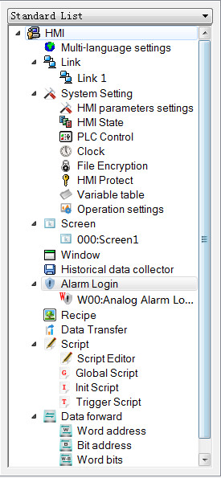

# Screen

Create a new screen as shown in Figure 7-17:

Figure 7-17    Right-click screen options

• Right click the "Screen" in the Project Manager, and then select "Add Screen" to create a new one. In the pop-up dialog box, set the properties such as "Screen Name"; click "OK".

• Two ways to open other screens: double click the screen name in the "Project Manager"; right click the screen name and select "Open" in the pop-up menu.

• Delete: Delete the screen by right clicking the screen name and selecting "Delete" in the pop-up menu.

• Property: Right click the screen name, and select "Property" in the pop-up menu; or, the select "Screen Properties" in the menu bar.

• Copy: Right click the screen name, and select "Copy" in the pop-up menu to copy; set the new screen name and click OK to complete.
