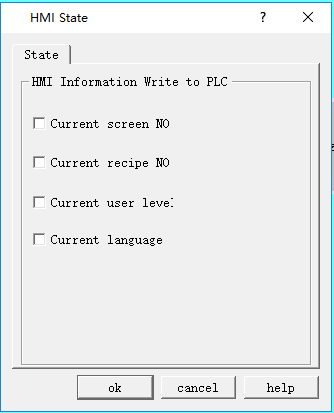

# HMI State

HMI state setting is employed to write the current HMI state information to the data register of PLC.

Double click the "HMI State" item in the Project Manager, a dialog box will pop up as shown in Figure 7-7:

Figure 7-7      HMI Status Setting

• Current screen NO: Write the serial number of the current HMI screen to the PLC.

• Current formula NO: When the serial number of the current formula to the PLC.

• Current user level: Write the current user level to the PLC.

• Current language: Write the serial number of the currently applied language to the PLC

Click "OK" HMI to complete the settings.
