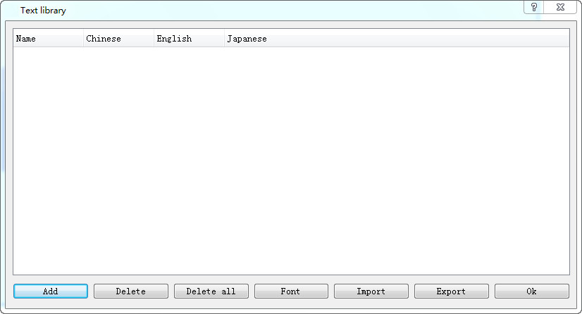
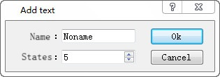
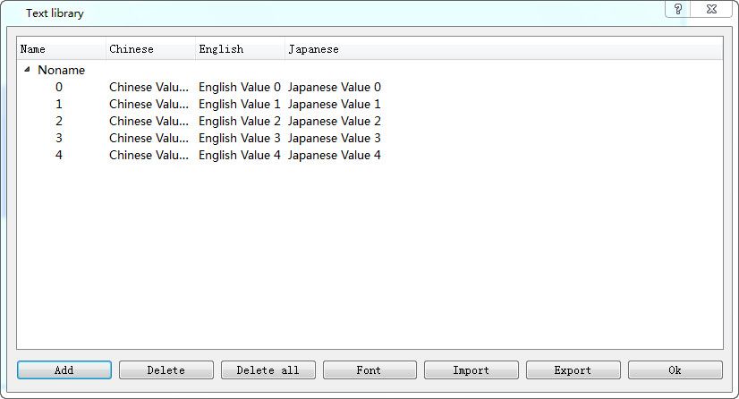
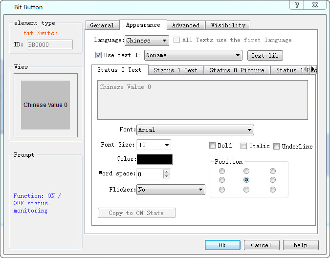
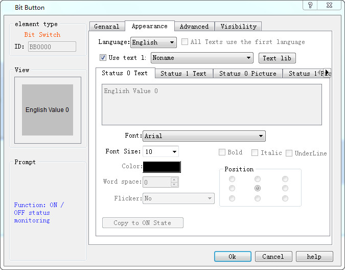
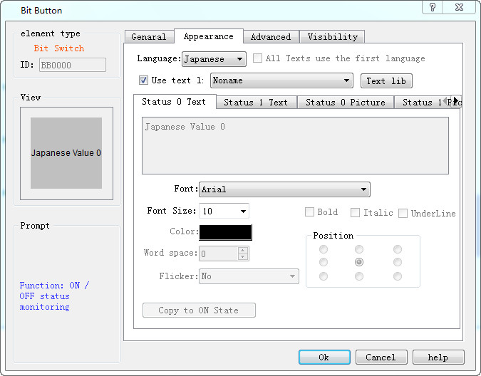
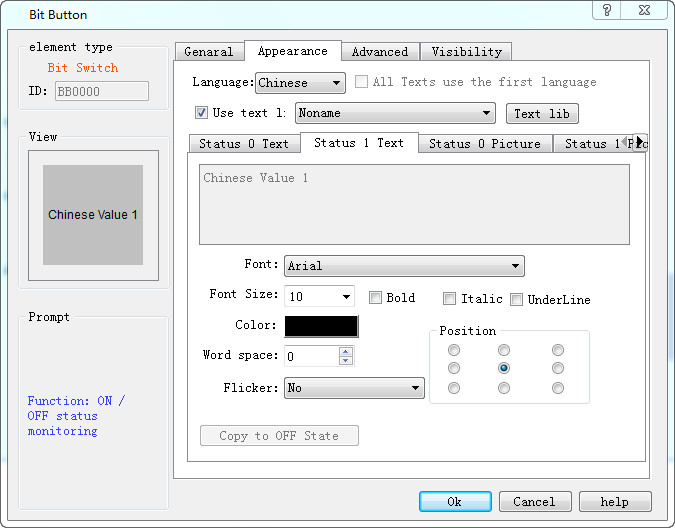

# Text Library

The text library control is used to set up a common text library for users to reduce the user's repeatable text data input.

This is a simple introduction to the control usage method.

1.      Building text library data

Set up the data of the text library control and set the number of states

Double-click the corresponding input area in the corresponding language to complete the data input

2.      Use the text library in the control

Take a switch example, check the text library, and choose the corresponding text after selecting the corresponding language

3.      Set different data for using the same variable in the text library

     When the control of the text library has a variety of states, it can be automatically switched to the corresponding text library data depending on the state of the state, or the switch to the position switch, when the text library data is automatically switched to state 1

              state 0 

state 1 
