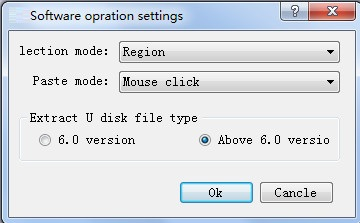

# The operation setting

Configuration operation Settings：

• choice model

regional choice: when the mouse choose regional section contains selected area can be selected to the control

controls selection: when the mouse choose region completely completely contains selected control can be selected to the control

•  paste mode

mouse click paste: copy control, click paste the user to choose paste placed control

same position paste: copy control, click paste, paste controls in place to be copied controls peripheral location

•  extract U diHM file type

6.Version 0: generate version 6.0 U diHM file

is higher than version 6.0: generate higher than version 6.0 U diHM file
