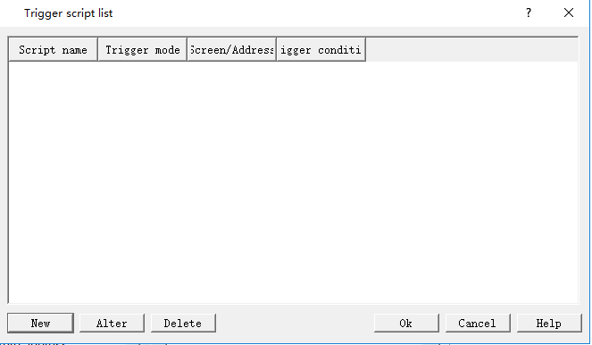
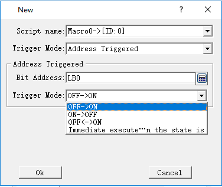
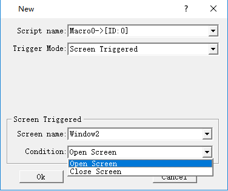
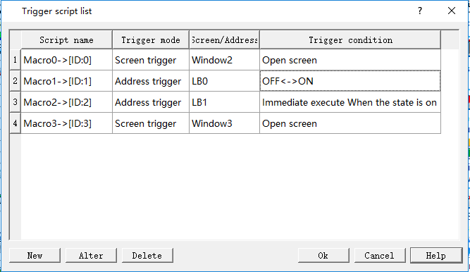

# Trigger_Script

Set a script that has been successfully compiled into an trigger script, executing this script when the assigned condition is triggered. The trigger condition include screen/window skip,and address value change.

Click "Trigger Script" on the menu "Setting", as shown in the dialog box:

Figure7-45 Trigger Script dialog

Click the “New” button  to pop up a new dialog. Then  select a script is executed as a trigger script when  the condition occur.

The trigger mode include address triggered and screen triggered.

Address Trigger:Set a Bit Address,select a trigger mode,include of OFF-&gt;ON,ON-&gt;OFF,OFF&lt;-&gt;ON,Immediate execute when the status is ON.

Screen Trigger:Set a screen Name as trigger condition,select a trigger mode,include of Open Screen and Close Screen.

Figure7-46 new trigger script

You can use “Alter”and “Delete”button to operate the scripts,finally create a trigger script list.

Figure7-47 trigger script list
