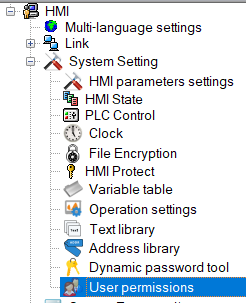
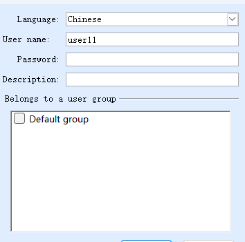
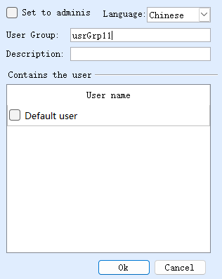

# User Permission

User permissions allow users to add user-defined users and user groups, thereby implementing permission control for operations in the configuration.

Ø  Add users and user groups

**Add user**

**add user group**

Deletion of default users and groups is not allowed
