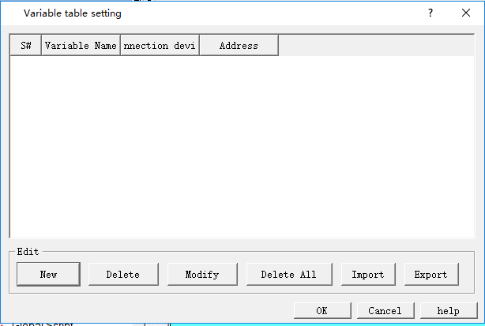
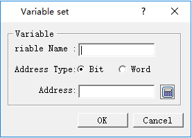

# Variable Table

Define a tag with an address. When the tag is employed, it corresponds to the corresponding address. To configure the variable settings, double click the "variable table" option in the "Project Manager", then a dialog box will pop up as shown in Figure 7-15:

Figure 7-15    Variable Table Setting Dialog Box

• New: Add a new tag; the maximum total number is 1000

• Delete: Delete the selected tag.

• Modify: Modify the selected tag or double click the selected tag.

• Delete all: Delete all variable tags.

• Import：pop up a open file dialog,import variable table file.

• Export :pop up a save as dialog,Export current variable table.

Figure 7-16    Create a screen switch through bit control dialog box

• Variable name: Set the name of the newly created variable.

• Address Type: Select the data type of the address.

• Address: Select the address of the connection.
