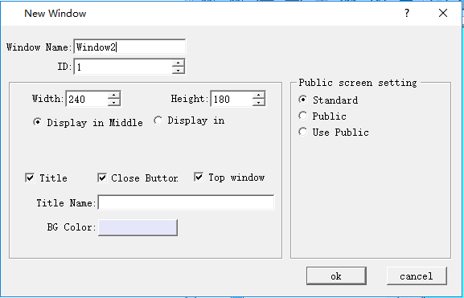

# Window

Way to add a new window is similar to that to create a new screen. Refer to screen operations for the open, delete, copy or properties of window. The Properties dialog box of the window is shown in Figure 7-18.

Open a window in screen, and a window will display in the screen.

Figure 7-18 Window Properties dialog box

• Height, Width: Set the height and width of the window respectively.

• Display in Middle: When the window pops up, it is displayed in the center of the HMI.

• Display in: Set the X-coordinate and Y-coordinate point on which to display the window. The origin of coordinates is the top left corner of the HMI screen.

• Title: Enter the title name that will pop up as a title bar with the window.

• Close Button: Whether the window has a close button.

• Top window：Whether lock other screen and window when this window opening.

• Background Color: Set the background color of the window.

• Standard:Not as a public window ,and not use public window.

• Public:  show the window’s all objects on the windows that select “use public”.

• Use Public:The window can show the “Public”window’s all objects and controls.
