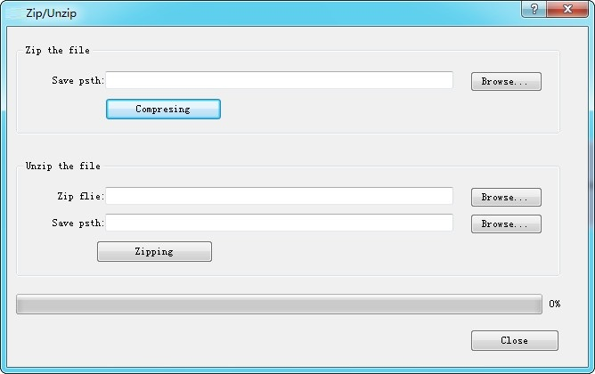

# Pack/Unpack

Select “Pack/Unpack” in the Download menu to open the dialog box.

• Zip the file: Zip the HM project file to generate a compressed file suffixed .sip. Used external images will be also packaged into the compressed file. If users send the compressed file to another computer, the images still exist after unzipping. However, if only send the configuration project file, you will lose external images in other computers because the external images could not find the original image path.

• Save Path: Location to store the compressed file; after selecting the save path, Click "Compression", and then close it when the progress bar reaches 100%.

• Unzip the file: Decompress a file-suffixed .vpr into that of .vpm which can be opened directly in CommandHMI.

• Zip file: Choose files to be extracted.

• Save Path: Location to store the decompressed file suffixed .vpm; after selecting the save path, Click "Zipping", and then close it when the progress bar reaches 100%.
