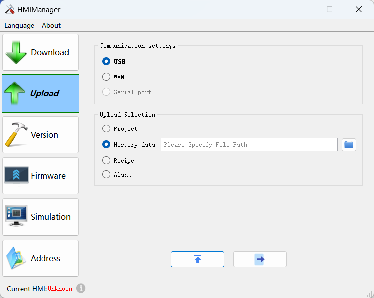

# Upload historical data record

Run CommandHMI configuration software; click .

Selecting “Upload historical data record” means uploading it from HMI to the hard disk.

• File Path: Storage location; select "Browse" to choose your storage path.

• File name: Name of the uploaded file; the uploaded file cannot be opened directly, so a data conversion tool is necessary. Refer to “Export historical data and alarm to U disk” in the Help appendix for specific operation.

• Click "Upload File" to start uploading while the file is stored in the set location.

• CommandHMI newly add multiple set of historical data, so uploading historical data means, in addition to uploading historical database file, and also saving each set of historical data in the database file as a .CSV file. E.g., uploading a file called " temp ", then the according historical database file is named “temp”, and that of CSV in group 0 is “temp_hisdata0.csv” while that of CSV in group 1 is “temp_hisdata1.csv”, and so on.

Operation of uploading historical data record is similar to that of uploading formula and project file; the function of converting files from Samdraw3.3 to CommandHMI is disabled.
