# Download configuration engineering

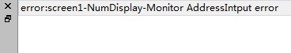

Figure 3-11    Prompt of compiling error

You can modify it according to the error hint in the information output window; or you can also double-click the error, then CommandHMI will automatically find the wrong object as well as select it. So engineers can double-click on the object to view its property settings, find the reason of the error and make appropriate alterations. After click the Save button to compile and execute the command again. If there is no error, the system will pop up a dialog box indicating successful compilation after a while. At last, click OK to finish it, as shown in Figure 3-12:

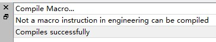

Figure 3-12    Information output window

It’s necessary to compile before downloading while the step of conservation is required before compiling. Otherwise it will fail to compile, as shown in Figure 3-11. After compilation, if you modify again, you need to compile again.

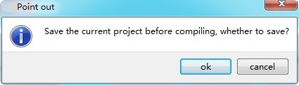

Figure 3-13    Compiling reminder

Finally, execute the command USB in Download menu to download through USB cable; engineers can also directly select the command Compile + Download in Download menu. The implementation of the operation brings up the following pop-up dialog box in Figure 3-14:

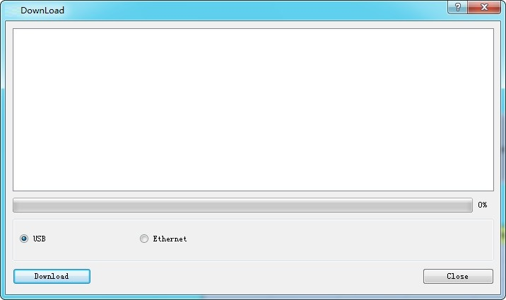

Figure 3-14    Download dialog

Click to download; the middle progress bar shows the downloading progress. After the downloading, a pop-up window shows the completion of USB download. Click OK to complete the downloading task, as shown in Figure 3-15:

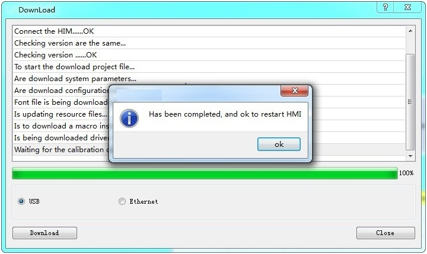

Figure 3-15    Downloading completed

The next step is the connection to the PLC to see whether the configuration project runs correctly in HMI.

Ways of connection between HMI and PLC or PC are shown in “Connection” in Hardware handbook.

Do not cut off the power of HMI, PC or USB cable and avoid other operations during the transmission process; otherwise it will be affected.

Please install the USB drivers before downloading; otherwise the PC will not be connected to HMI. Thus you will not be able to complete the downloading task.

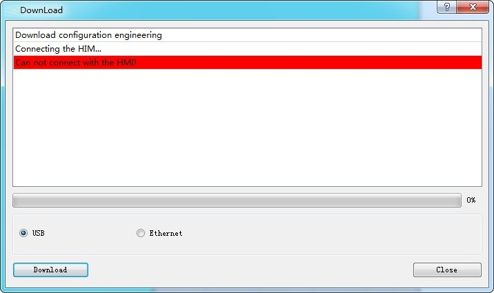

Figure 3-16    USB driver prompt

The pop-up dialog box, as shown in Figure 3-16, means that the PC does not recognize the HMI. Now it is necessary to check whether the USB driver has been installed: Connect the PC and power-on HMI, and then search “CommandHMI HMI Tech Corp USB drive” in the Windows "My Computer" - "Properties" - "Hardware" - "Device Manager" - "Universal Serial Bus controllers".  (you can try to pull out the USB cable to check if the PC can recognize HMI):

**Configuration downloading through Ethernet**

• Set HMI network parameter settings

Open the dial switch 1 and 3 together; set the IP that can be set accordingly (here set it as 192.168.1.100), gateway, subnet and port. Fix the port to 12345.

• Compile the configuration

If select downloading configuration through Ethernet it is necessary to input IP address and port number in the input box. IP is that of the downloading target HMI. The IP here is 192.168.1.100 as above, and the port is fixed to 12345. Then click to restart and download, as shown in Figure 3-18:

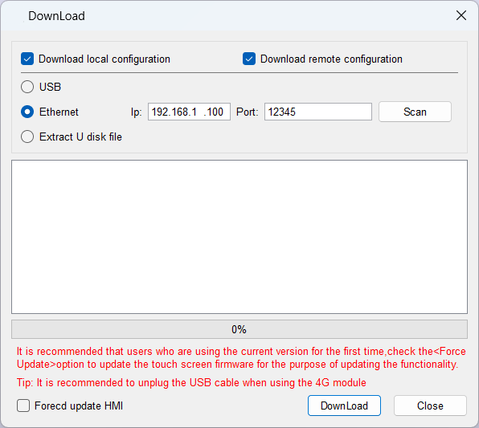

Figure 3-18 Configuration downloading through Ethernet

You can also click on the Scan button for IP address scanning

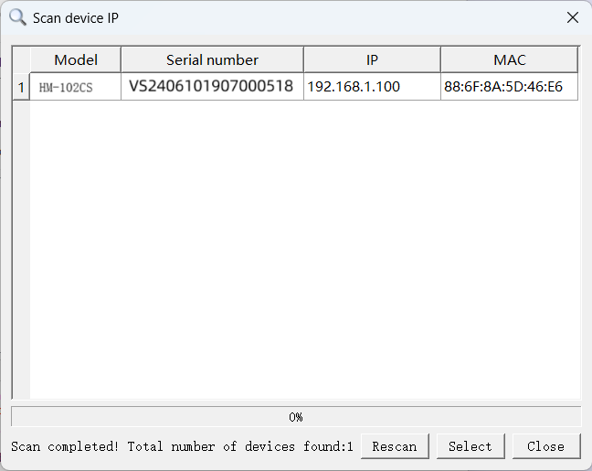

You can check the scanned IP address and modify it in the modification box below

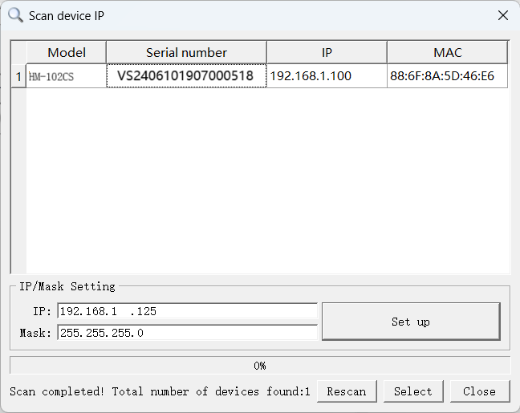

Click the button on the right to make changes to the on-screen information, and a pop-up window will appear when you're done.

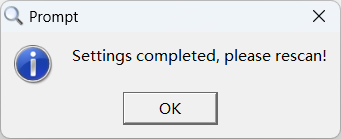

At this point, click Rescan, you can see that the modified results have been displayed in the list.

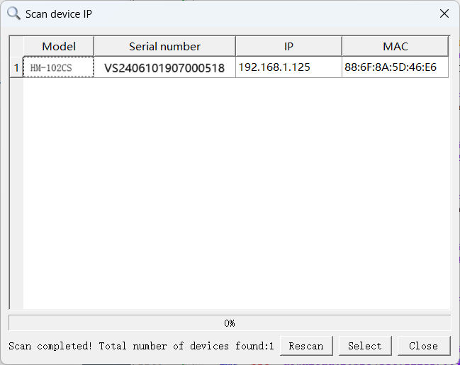

Check the IP address you need to use and click the Select button to complete the selection of the target IP, the IP information will be synchronized to the download window interface.

**Caution!**

When using the IP scanning function, you should ensure that the following three requirements are realized:

1. Touch panels manufactured before December 30, 2024 need to manually update the corresponding IP scanning patch package, if you do not find the "hmi.patch" file in the installation directory, please contact the technical staff to obtain it.
     2. Configuration software version must not be lower than HMITOOLV7.1_022
     3. Firmware version must not be lower than Simulator 8.1.0.10.

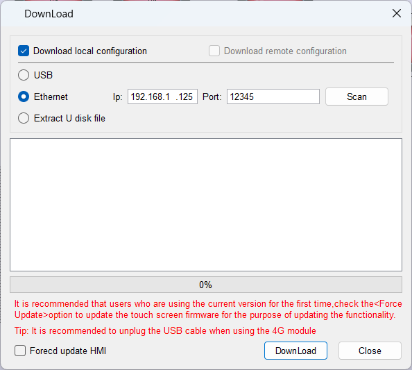
