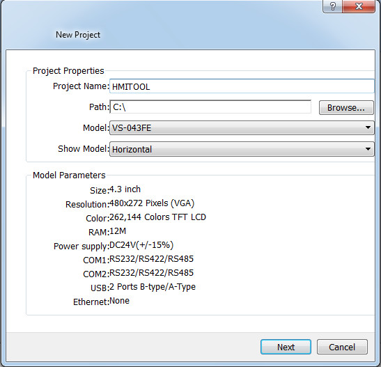
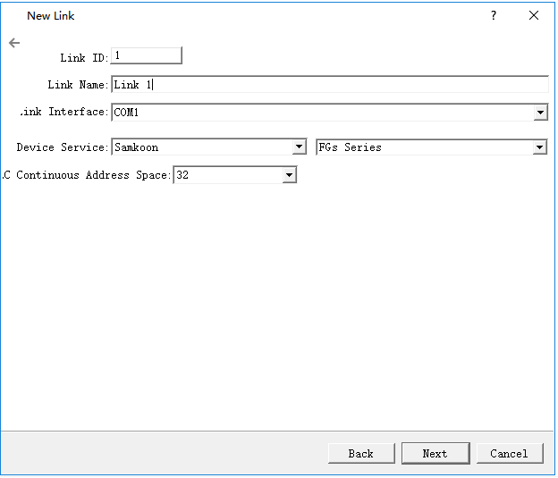
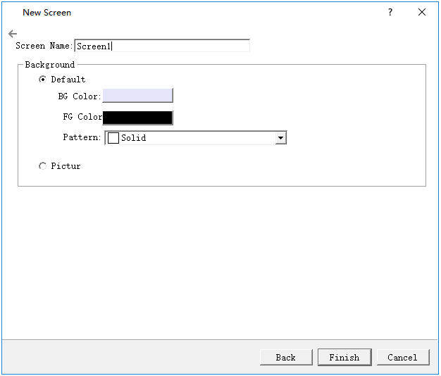
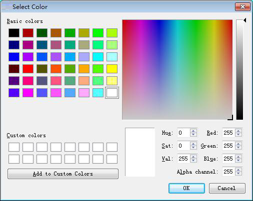
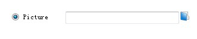

# Create new project

This operation is necessary when engineers need to create a new project. Select New Project in the File menu or New Project button in the tool bar, then CommandHMI will pop up the "New Project dialog box" where you can decide the name and storage path of the project. Select the corresponding HMI model; click OK to complete creating a new project and enter into the dialog box of Communication port settings; click Cancel to exit the dialog box.

**1.New project dialog box**

Project name:

Path: Storage path of new project file; the default is C: \\

Model: Available models for projects:

HM-035AE(320\*240)        HM-035UE(320\*240)        HM-043AE()480\*272        HM-043D(480\*272)        HM-043AD(480-272)        HM-043BE(480\*272)        HM-043BS(480\*272)        HM-043QE(480\*272)        HM-043UE(480\*272)        HM-043TE(480\*272)        HM-050AS(480\*272)        HM-050AE(480\*272)        HM-050BS(800\*480)        HM-050BE(800\*480)        HM-057AE(640\*480)        HM-070AS(800\*480)        HM-070AE(800\*480)        HM-070BS(800\*480)        HM-070BE(800\*480)        HM-070GS(800\*480)        HM-070GE(800\*480)        HM-070QS(800\*480)        HM-070QE(800\*480)        HM-070GG(800\*480)        HM-070GW(800\*480)        HM-070MS(800\*480)        HM-070ME(800\*480)        HM-070MG(800\*480)        HM-070MW(800\*480)        HM-T070XS(1024\*600)        HM-102AS(800\*480)        HM-102AE(800\*480)        HM-102BS(1024\*600)        HM-102BE(1024\*600)        HM-102CW(1024\*600)        HM-102CG(1024\*600)        HM-102HE(1024\*600)        HM-102HS(1024\*600)        HM-121AS(800\*600)        HM-121AE(800\*600)        HM-H150AS(1024\*768)        HM-156QS(1920\*1080)

The default model is HM-070AE(800\*480), the screen resolution (800 \* 480) in the bracket is not displayed in the dialog box.

Display mode: Display direction of the touch screen used by the project. Available models include:

Horizontal: Configuration with the touch screen being horizontal.

Vertical: Configuration with the touch screen being vertical.

The default mode is Horizontal.

Figure 3-1      New project dialog box

The figure above is the New Project dialog box where engineers decide the Name, Path, Model and Display Mode, then click Next to set communication port.

Specific model is determined by the HMI model that user has.

The name of the new project cannot contain the following characters: \\ /: \* "&lt;&gt; \|?.

The location of the new project cannot contain the following characters: \\ /: \* "&lt;&gt; \|?.

## 2. Communication Settings dialog box

Communication settings dialog box is used to set communication parameters of the communication port of HMI. Only correct communication parameters can ensure normal communication between PLC and touch screens. The specific communication parameters depend on the model of PLC to be connected.

Connection Name: The name of the communication port.

Device Service: Selection of PLC brand and CPU type.

Connection Interface: Select COM port or Ethernet port.

PLC Continuous Address Interval: Set PLC consecutive address space; the default value is recommended.

##

Figure 3-2      Communication setting dialog box

The figure above is the dialog box of communication port settings where engineers choose corresponding device services according to types of connection devices. To use Ethernet connection, choose “Direct Connection(Ethernet)” option in the “Connection Type”.

Connection ID: Internal parameters cannot be changed!

When you configure the communication properties can also be set in the Project Manager connection, the other parameters are set in the communication properties.

**3.       Screen Properties settings box**

Click “Next” in the Communication settings dialog box to pop up a New Screen dialog box where you can set the name and the background color of screens. The default name is a screen number; the default background color is blue. When we create a new picture every time, CommandHMI configuration software will assign a screen number to the new screen to indicate the screen order of the current project. Numbers start from 1, that is, the serial number of the first frame 1. No. 5 is the fifth screen. To change the background color of the new screen, just click the rectangle behind the Background Color to bring up the color selection frame. With more than two hundred kinds of colors for users to select quickly, CommandHMI software provides the most extensive selection of color. If you are dissatisfied still, you can click on the lower right of the color selection box to customize color. In the Custom Colors dialog box, select the basic color first, then color in the middle of the square area; drag the mouse to adjust the desired color area; you can also type in the right vertical rectangle and drag the mouse to complete the desired color, at last click OK. You can also enter directly basic color values.

Figure 3-3      New screen dialog box

Figure 3-4      Color selection dialog box

Engineers can also choose own pictures as the screen background. Click the path icon to find the image path.

Figure 3-5      Set the path of picture

Click OK to complete the above steps, the system will immediately open the screen you just created. Preparations for new construction are done. Then it’s time to edit own configuration project.
