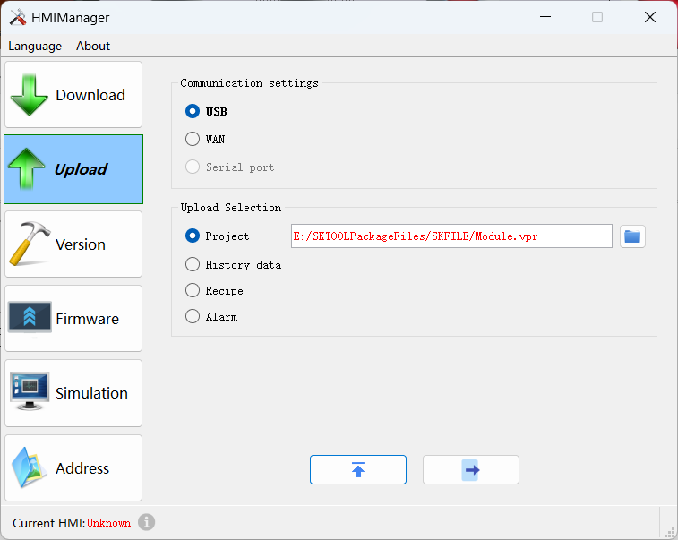

# Upload configuration engineering

CommandHMI software supports uploading configuration program from the HMI to the hard disk. Connect HMI to PC; select the option of "Upload project file" in the pop-up dialog box, and then the user interface of "Upload Samdraw file" will appear.

• File Path: Click "Browse" to select the file in which you want to save the path.

• Project Name: Set the name of the project.

• Start uploading: Click Upload file to start.

After the success of the uploading, you can choose whether to open the project file.

It needs to extract the uploaded file before open it.
